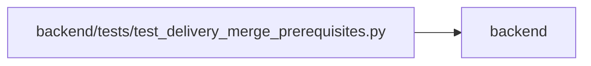

# test_delivery_merge_prerequisites Module

**Path:** `backend/tests/test_delivery_merge_prerequisites.py`

## Description

A delivery prerequisite can require accepted code merged on a named branch; the hold names who acts next.

## Imports

| Source | Symbols |
|--------|---------|
| `app.authority` | `Authority`, `AuthorityError` |
| `app.commands` | `command_transaction` |
| `app.config` | `get_settings` |
| `app.models.agent` | `AgentActor`, `AgentRun`, `TaskEvent` |
| `app.models.identity` | `Principal` |
| `app.models.task` | `Task` |
| `app.schemas.request_source` | `RequestSourceCreate`, `RequestSourceLinkCreateRequest` |
| `app.schemas.task_brief` | `BriefWrite`, `TaskBrief` |
| `app.services.agent_service` | `AgentService` |
| `app.services.delivery_dependency_service` | `DeliveryDependencyService` |
| `app.services.external_link_service` | `ExternalLinkService` |
| `app.services.github_reconciliation_service` | `GitHubReconciliationService` |
| `app.services.github_status_service` | `GitHubStatusService` |
| `app.services.github_webhook_service` | `GitHubWebhookService` |
| `app.services.request_source_service` | `RequestSourceService` |
| `app.services.task_brief_service` | `TaskBriefService` |
| `app.services.task_context_revision_service` | `reserve_task_context_revision` |
| `app.utils.time` | `utc_now` |
| `httpx` | `httpx` |
| `json` | `json` |
| `pytest` | `pytest` |
| `sqlalchemy` | `select` |
| `sqlalchemy.orm.attributes` | `set_committed_value` |
| `tests.test_delivery_dependencies` | `pair` |
| `tests.test_delivery_scenarios` | `delivery_store` |
| `tests.test_github_reconciliation` | `github` |

## Local dependency map

<!-- Auto-generated local dependency summary. Do not edit by hand. -->

> Module-level dependencies exceed the generated-diagram limits, so the diagram and table below group them by top-level package. Counts report the number of module neighbors in each package.

### Internal neighbors

| Direction | Module |
|---|---|
| Outbound | `backend` (21) |

### External packages

| Language | Used packages | Undeclared packages |
|---|---:|---:|
| python | 3 | 1 |

> All 21 module neighbor(s) are summarized by package because the module-level view exceeds the 12-node limit.

## Functions

| Function | Signature | Decorators | Description |
|----------|-----------|------------|-------------|
| `observe` | *(async)* `(db, task, number, *, status, base = 'main', merge = True)` | — | — |
| `accept` | *(async)* `(db, task)` | — | — |
| `hold` | *(async)* `(db, task_id)` | — | — |
| `test_implemented_prerequisite_with_open_pull_request_holds_with_reviewer` | *(async)* `(delivery_store)` | — | — |
| `test_accepted_prerequisite_absent_from_target_holds_with_pm` | *(async)* `(delivery_store)` | — | — |
| `test_verified_merge_on_target_releases_the_hold_and_ordinary_edges_are_unchanged` | *(async)* `(delivery_store)` | — | — |
| `test_merge_without_acceptance_never_releases_and_branch_is_validated` | *(async)* `(delivery_store)` | — | — |
| `test_pipeline_shows_the_hold_on_the_waiting_task` | *(async)* `(delivery_store)` | — | — |
| `test_merged_pull_request_without_a_recorded_base_branch_asks_for_catch_up` | *(async)* `(delivery_store)` | — | — |
| `test_merged_without_a_merge_commit_on_the_target_is_not_confirmed` | *(async)* `(delivery_store)` | — | — |
| `test_canceled_prerequisite_is_replaced_by_the_pm` | *(async)* `(delivery_store)` | — | — |
| `test_closed_prerequisite_with_stale_acceptance_is_reopened_by_the_pm` | *(async)* `(delivery_store)` | — | — |
| `accepted_with_pull_request` | *(async)* `(db, scenario)` | — | An accepted, closed prerequisite whose run submitted a commit for its one pull request. |
| `record_merge` | *(async)* `(db, observer, github, task_id, head)` | — | — |
| `preserved_events` | *(async)* `(db, task_id)` | — | — |
| `test_an_observed_merge_keeps_acceptance_and_releases_the_dependent` | *(async)* `(delivery_store, github, observer)` | `@pytest.mark.parametrize('observer', ['catch_up', 'webhook'])` | — |
| `test_a_head_pushed_after_acceptance_makes_acceptance_stale` | *(async)* `(delivery_store, github, observer)` | `@pytest.mark.parametrize('observer', ['catch_up', 'webhook'])` | — |
| `test_other_context_changes_still_make_acceptance_stale` | *(async)* `(delivery_store, change)` | `@pytest.mark.parametrize('change', ['github_link', 'request_source'])` | — |
| `test_a_brief_change_still_makes_acceptance_stale` | *(async)* `(delivery_store)` | — | — |
| `test_an_observation_without_a_head_makes_acceptance_stale` | *(async)* `(delivery_store, github, observer)` | `@pytest.mark.parametrize('observer', ['catch_up', 'webhook'])` | — |
| `test_a_recorded_provider_error_keeps_acceptance` | *(async)* `(delivery_store, github, monkeypatch)` | — | — |
| `edit_only_agent` | `(db, project_id)` | — | A PM agent that may edit planning but holds no work:execute scope. |
| `preserve` | *(async)* `(db, task_id)` | — | — |
| `test_an_edit_only_agent_carries_acceptance_only_through_a_preserving_observation` | *(async)* `(delivery_store)` | — | — |
| `test_an_edit_only_agent_cannot_refresh_a_stale_acceptance_by_hand` | *(async)* `(delivery_store)` | — | — |
| `test_a_preserving_observation_grants_no_other_acceptance_value` | *(async)* `(delivery_store, offset)` | `@pytest.mark.parametrize('offset', [5, None, -2], ids=['ahead', 'cleared', 'behind'])` | — |
| `test_a_preserving_observation_authorizes_one_flush` | *(async)* `(delivery_store)` | — | — |
| `test_undoing_a_preserved_acceptance_leaves_it_stale` | *(async)* `(delivery_store)` | — | version - 1 is the acceptance before the reservation: no grant is used and acceptance is stale. |
| `test_a_preserving_observation_grants_nothing_from_another_previous_acceptance` | *(async)* `(delivery_store)` | — | — |
