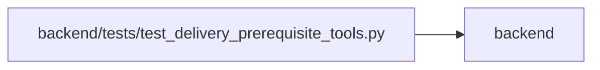

# test_delivery_prerequisite_tools Module

**Path:** `backend/tests/test_delivery_prerequisite_tools.py`

## Description

Agents read GitHub reconciliation, run catch-up and retarget delivery prerequisites with the REST authority.

## Imports

| Source | Symbols |
|--------|---------|
| `app` | `mcp_server` |
| `app.agent_contract` | `agent_contract_features` |
| `app.authority` | `internal_authority` |
| `app.models.agent` | `AgentActor`, `TaskEvent`, `AgentActor`, `AgentRun` |
| `app.models.delivery_dependency` | `DeliveryDependency` |
| `app.models.external_link` | `ExternalLink`, `ExternalLink` |
| `app.models.identity` | `Principal`, `ProjectMembership` |
| `app.models.iteration` | `Iteration` |
| `app.models.project` | `Project` |
| `app.models.task` | `Task` |
| `app.models.user_session` | `UserSession` |
| `app.schemas.delivery_dependency` | `DeliveryDependencyRetarget` |
| `app.server_features` | `SERVER_FEATURES` |
| `app.services.agent_service` | `hash_api_key` |
| `app.services.external_link_service` | `ExternalLinkService` |
| `app.services.identity_service` | `digest` |
| `app.utils.time` | `utc_now` |
| `contextlib` | `asynccontextmanager` |
| `datetime` | `timedelta` |
| `httpx` | `httpx` |
| `json` | `json` |
| `pydantic` | `ValidationError` |
| `pytest` | `pytest` |
| `sqlalchemy` | `select` |
| `tests.test_delivery_scenarios` | `delivery_store` |
| `tests.test_github_reconciliation` | `MERGE`, `REPO`, `github` |
| `tests.test_managed_authority` | `client`, `managed_store` |

## Local dependency map

<!-- Auto-generated local dependency summary. Do not edit by hand. -->

> Module-level dependencies exceed the generated-diagram limits, so the diagram and table below group them by top-level package. Counts report the number of module neighbors in each package.

### Internal neighbors

| Direction | Module |
|---|---|
| Outbound | `backend` (20) |

### External packages

| Language | Used packages | Undeclared packages |
|---|---:|---:|
| python | 4 | 1 |

> All 20 module neighbor(s) are summarized by package because the module-level view exceeds the 12-node limit.

## Functions

| Function | Signature | Decorators | Description |
|----------|-----------|------------|-------------|
| `_agent` | *(async)* `(db, key, name, *, scopes, memberships)` | — | — |
| `team` | *(async)* `(managed_store)` | `@pytest.fixture` | The PM manages both projects; the others are refused for team scope, project role or credential scope. |
| `_observe_merge` | *(async)* `(factory, link_id, base)` | — | — |
| `_version` | *(async)* `(factory, task_id)` | — | — |
| `transport_api` | *(async)* `(transport, factory, monkeypatch)` | `@asynccontextmanager` | Call one command through REST or MCP; a refusal returns the error text instead of the result. |
| `_nothing` | *(async)* `()` | `@asynccontextmanager` | — |
| `_retarget` | `(call, key, task_id, edge_id, version, branch, receipt)` | — | — |
| `_add` | `(call, key, task_id, target_id, version, branch, receipt)` | — | — |
| `_list` | `(call, key, task_id)` | — | — |
| `test_new_tools_declare_their_inputs_and_contract_features` | *(async)* `()` | — | — |
| `test_retarget_body_requires_an_explicit_branch_or_null` | `()` | — | — |
| `test_retarget_releases_and_holds_dependent_work_and_is_on_the_timeline` | *(async)* `(team, transport, monkeypatch)` | `@pytest.mark.parametrize('transport', ['rest', 'mcp'])` | — |
| `test_an_mcp_retry_with_the_same_key_replays_the_receipt` | *(async)* `(team, monkeypatch)` | — | — |
| `test_another_teams_pm_and_read_only_credentials_change_nothing` | *(async)* `(team, github, transport, key, monkeypatch)` | `@pytest.mark.parametrize('transport', ['rest', 'mcp'])`, `@pytest.mark.parametrize('key', [OTHER_PM_KEY, VIEWER_KEY, READER_KEY])` | — |
| `test_an_observer_session_reads_but_cannot_retarget_or_catch_up` | *(async)* `(team, github)` | — | — |
| `test_catch_up_records_the_missed_merge_and_releases_the_dependent` | *(async)* `(team, github, transport, monkeypatch)` | `@pytest.mark.parametrize('transport', ['rest', 'mcp'])` | — |
| `test_catch_up_records_every_linked_pull_requests_own_observation` | *(async)* `(team, github, transport, monkeypatch)` | `@pytest.mark.parametrize('transport', ['rest', 'mcp'])` | — |
| `test_catch_up_over_several_links_keeps_acceptance_only_for_the_submitted_heads` | *(async)* `(team, github, transport, case, monkeypatch)` | `@pytest.mark.parametrize('transport', ['rest', 'mcp'])`, `@pytest.mark.parametrize('case', ['heads_match', 'one_head_moved', 'provider_error_and_match'])` | — |
