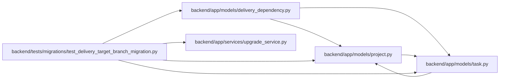

# test_delivery_target_branch_migration Module

**Path:** `backend/tests/migrations/test_delivery_target_branch_migration.py`

## Description

A delivery prerequisite's target branch migrates reversibly and is never dropped silently.

## Imports

| Source | Symbols |
|--------|---------|
| `alembic` | `command` |
| `app.models.delivery_dependency` | `DeliveryDependency` |
| `app.models.project` | `Project` |
| `app.models.task` | `Task` |
| `app.services.upgrade_service` | `alembic_config` |
| `pytest` | `pytest` |
| `sqlalchemy` | `create_engine`, `inspect`, `select` |

## Local dependency map

<!-- Auto-generated local dependency summary. Do not edit by hand. -->

### Internal neighbors

| Direction | Module |
|---|---|
| Outbound | [delivery_dependency](../modules/delivery_dependency.md) |
| Outbound | [models_project](../modules/models_project.md) |
| Outbound | [models_task](../modules/models_task.md) |
| Outbound | [upgrade_service](../modules/upgrade_service.md) |

### External packages

| Language | Used packages | Undeclared packages |
|---|---:|---:|
| python | 3 | 1 |

## Functions

| Function | Signature | Decorators | Description |
|----------|-----------|------------|-------------|
| `test_target_branch_migration_keeps_edges_and_refuses_losing_a_branch` | `(dialect, request, tmp_path, configure_database)` | `@pytest.mark.parametrize('dialect', [pytest.param('sqlite', marks=pytest.mark.sqlite), pytest.param('postgresql', marks=[pytest.mark.postgresql, pytest.mark.integration, pytest.mark.allow_network])])` | — |
