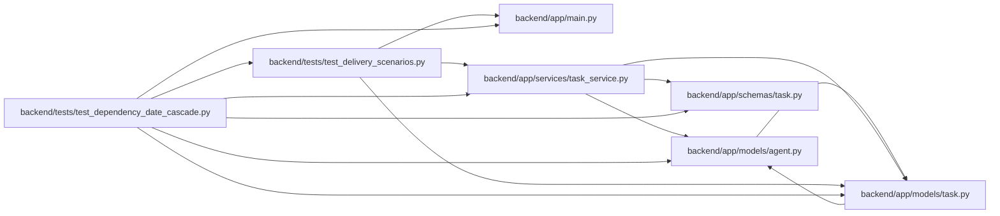

# test_dependency_date_cascade Module

**Path:** `backend/tests/test_dependency_date_cascade.py`

## Description

A late start moves each planned dependent once, however many paths reach it.

## Imports

| Source | Symbols |
|--------|---------|
| `app.main` | `app` |
| `app.models.agent` | `TaskEvent` |
| `app.models.task` | `Task` |
| `app.schemas.task` | `TaskCreate` |
| `app.services.task_service` | `TaskService` |
| `collections` | `Counter` |
| `datetime` | `date`, `timedelta` |
| `httpx` | `httpx` |
| `json` | `json` |
| `sqlalchemy` | `select` |
| `tests.test_delivery_scenarios` | `delivery_store` |

## Local dependency map

<!-- Auto-generated local dependency summary. Do not edit by hand. -->

### Internal neighbors

| Direction | Module |
|---|---|
| Outbound | [app_main](../modules/app_main.md) |
| Outbound | [models_agent](../modules/models_agent.md) |
| Outbound | [models_task](../modules/models_task.md) |
| Outbound | [schemas_task](../modules/schemas_task.md) |
| Outbound | [task_service](../modules/task_service.md) |
| Outbound | [test_delivery_scenarios](../modules/test_delivery_scenarios.md) |

### External packages

| Language | Used packages | Undeclared packages |
|---|---:|---:|
| python | 2 | 0 |

## Functions

| Function | Signature | Decorators | Description |
|----------|-----------|------------|-------------|
| `_seed_lattice` | *(async)* `(factory, scenario)` | — | Create a source and LAYERS x WIDTH tasks, each depending on the whole layer before it. |
| `test_late_start_moves_every_reachable_planned_task_exactly_once` | *(async)* `(delivery_store)` | — | — |
| `test_each_dependent_names_the_predecessor_it_was_reached_through` | *(async)* `(delivery_store)` | — | — |
