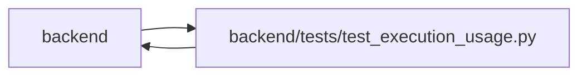

# test_execution_usage Module

**Path:** `backend/tests/test_execution_usage.py`

## Description

Usage provenance, corrections, immutable pricing and permission isolation.

## Imports

| Source | Symbols |
|--------|---------|
| `app` | `mcp_agent_tools` |
| `app.commands` | `command_transaction` |
| `app.main` | `app` |
| `app.models.agent` | `AgentActor`, `AgentRun` |
| `app.models.execution_usage` | `ExecutionUsageRecord` |
| `app.schemas.execution_usage` | `ExecutionUsageWrite`, `UsagePricingBasis` |
| `app.services.agent_service` | `AgentConflictError`, `AgentPermissionError` |
| `app.services.execution_usage_service` | `ExecutionUsageService`, `estimate_cost` |
| `app.services.identity_service` | `IdentityService` |
| `app.utils.time` | `utc_now` |
| `asyncio` | `asyncio` |
| `datetime` | `timedelta` |
| `decimal` | `Decimal` |
| `httpx` | `httpx` |
| `pytest` | `pytest` |
| `sqlalchemy` | `func`, `select` |
| `tests.test_delivery_scenarios` | `delivery_store` |

## Local dependency map

<!-- Auto-generated local dependency summary. Do not edit by hand. -->

> Module-level dependencies exceed the generated-diagram limits, so the diagram and table below group them by top-level package. Counts report the number of module neighbors in each package.

### Internal neighbors

| Direction | Module |
|---|---|
| Inbound | `backend` (1) |
| Outbound | `backend` (11) |

### External packages

| Language | Used packages | Undeclared packages |
|---|---:|---:|
| python | 3 | 1 |

> All 12 module neighbor(s) are summarized by package because the module-level view exceeds the 12-node limit.

## Functions

| Function | Signature | Decorators | Description |
|----------|-----------|------------|-------------|
| `seed_run` | *(async)* `(factory, scenario)` | — | — |
| `usage` | `(now, **overrides)` | — | — |
| `test_usage_zero_unknown_and_currency_validation` | `()` | — | — |
| `test_usage_replay_correction_and_currency_buckets` | *(async)* `(delivery_store)` | — | — |
| `test_usage_unknown_without_reports_and_foreign_reporter_is_denied` | *(async)* `(delivery_store)` | — | — |
| `test_usage_rest_mcp_parity_and_readonly_human_summary` | *(async)* `(delivery_store)` | — | — |
| `test_reported_zero_and_unknown_are_not_repriced_by_live_metadata` | *(async)* `(delivery_store)` | — | — |
| `test_usage_correction_is_versioned_and_atomic` | *(async)* `(delivery_store)` | — | — |
| `test_concurrent_usage_corrections_reserve_one_head` | *(async)* `(delivery_store)` | — | — |
| `test_human_effort_is_a_measurement_for_coverage` | `(effort, coverage)` | `@pytest.mark.parametrize('effort', [None, Decimal('0'), Decimal('12.5')])`, `@pytest.mark.parametrize('coverage', ['complete', 'partial', 'unavailable'])` | — |
| `test_human_only_usage_summary_preserves_zero_and_unknown` | *(async)* `(delivery_store)` | — | — |
