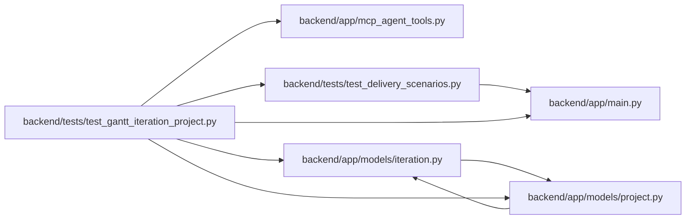

# test_gantt_iteration_project Module

**Path:** `backend/tests/test_gantt_iteration_project.py`

## Description

The Gantt projection names the project that owns its iteration, over REST and MCP.

## Imports

| Source | Symbols |
|--------|---------|
| `app.main` | `app` |
| `app.mcp_agent_tools` | `get_iteration`, `get_iteration_gantt` |
| `app.models.iteration` | `Iteration` |
| `app.models.project` | `Project` |
| `datetime` | `date` |
| `httpx` | `httpx` |
| `pytest` | `pytest` |
| `tests.test_delivery_scenarios` | `delivery_store` |

## Local dependency map

<!-- Auto-generated local dependency summary. Do not edit by hand. -->

### Internal neighbors

| Direction | Module |
|---|---|
| Outbound | [app_main](../modules/app_main.md) |
| Outbound | [mcp_agent_tools](../modules/mcp_agent_tools.md) |
| Outbound | [models_iteration](../modules/models_iteration.md) |
| Outbound | [models_project](../modules/models_project.md) |
| Outbound | [test_delivery_scenarios](../modules/test_delivery_scenarios.md) |

### External packages

| Language | Used packages | Undeclared packages |
|---|---:|---:|
| python | 2 | 1 |

## Functions

| Function | Signature | Decorators | Description |
|----------|-----------|------------|-------------|
| `_add_unscoped_iteration` | *(async)* `(db, bound_iteration_id)` | — | — |
| `test_gantt_rest_carries_owning_project_for_bound_and_unscoped_iterations` | *(async)* `(delivery_store)` | — | — |
| `test_gantt_mcp_carries_owning_project_for_bound_and_unscoped_iterations` | *(async)* `(delivery_store)` | — | — |
