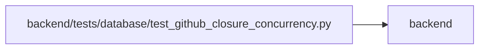

# test_github_closure_concurrency Module

**Path:** `backend/tests/database/test_github_closure_concurrency.py`

## Description

A GitHub merge or closure observed by racing catch-ups and webhooks is recorded once on PostgreSQL.

## Imports

| Source | Symbols |
|--------|---------|
| `__future__` | `annotations` |
| `app.authority` | `Authority` |
| `app.config` | `get_settings` |
| `app.database_config` | `parse_database_configuration` |
| `app.models.agent` | `TaskEvent` |
| `app.models.calendar` | `Calendar` |
| `app.models.external_link` | `ExternalLink` |
| `app.models.iteration` | `Iteration` |
| `app.models.project` | `Project` |
| `app.models.task` | `Task` |
| `app.services.external_link_service` | `ExternalLinkService` |
| `app.services.github_status_service` | `GitHubStatusService` |
| `app.services.github_webhook_service` | `GitHubWebhookService` |
| `app.services.upgrade_service` | `bootstrap_database_schema` |
| `asyncio` | `asyncio` |
| `datetime` | `date` |
| `httpx` | `httpx` |
| `pytest` | `pytest` |
| `pytest_asyncio` | `pytest_asyncio` |
| `sqlalchemy` | `select` |
| `sqlalchemy.ext.asyncio` | `AsyncEngine`, `AsyncSession`, `async_sessionmaker`, `create_async_engine` |
| `tests.support` | `AsyncBarrier` |

## Local dependency map

<!-- Auto-generated local dependency summary. Do not edit by hand. -->

> Module-level dependencies exceed the generated-diagram limits, so the diagram and table below group them by top-level package. Counts report the number of module neighbors in each package.

### Internal neighbors

| Direction | Module |
|---|---|
| Outbound | `backend` (14) |

### External packages

| Language | Used packages | Undeclared packages |
|---|---:|---:|
| python | 4 | 2 |

> All 14 module neighbor(s) are summarized by package because the module-level view exceeds the 12-node limit.

## Functions

| Function | Signature | Decorators | Description |
|----------|-----------|------------|-------------|
| `factory` | *(async)* `(postgres_database, configure_database) -> async_sessionmaker[AsyncSession]` | `@pytest_asyncio.fixture` | — |
| `_pull` | `(number: int, *, merged: bool) -> dict` | — | — |
| `_session` | `(factory, project_id: int) -> AsyncSession` | — | — |
| `_seed` | *(async)* `(factory, number: int) -> tuple[int, int, int]` | — | An open pull request linked to a task, as the last observation left it. |
| `_transport` | `(pull: dict, barrier: AsyncBarrier) -> httpx.MockTransport` | — | — |
| `_catch_up` | *(async)* `(factory, project_id: int, link_id: int, pull: dict, barrier: AsyncBarrier) -> None` | — | — |
| `_webhook` | *(async)* `(factory, project_id: int, pull: dict, barrier: AsyncBarrier, delivery_id: str) -> None` | — | — |
| `_closure_events` | *(async)* `(factory, task_id: int) -> list[str]` | — | — |
| `test_two_racing_catch_ups_record_the_closure_once` | *(async)* `(factory, merged) -> None` | `@pytest.mark.parametrize('merged', [True, False], ids=['merge', 'unmerged-closure'])` | — |
| `test_a_catch_up_racing_the_closure_webhook_records_the_closure_once` | *(async)* `(factory, merged) -> None` | `@pytest.mark.parametrize('merged', [True, False], ids=['merge', 'unmerged-closure'])` | — |
