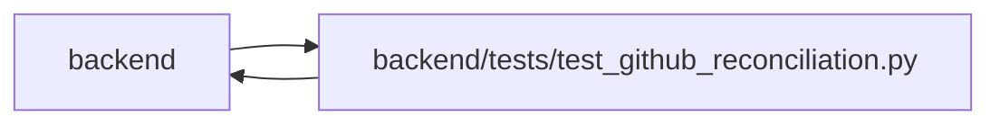

# test_github_reconciliation Module

**Path:** `backend/tests/test_github_reconciliation.py`

## Description

A task's submitted commit is reconciled with its linked pull request as GitHub shows it now.

## Imports

| Source | Symbols |
|--------|---------|
| `app.authority` | `Authority`, `AuthorityError` |
| `app.config` | `get_settings` |
| `app.models.agent` | `AgentRun`, `AgentTaskAssignment`, `TaskEvent` |
| `app.models.external_link` | `ExternalLink` |
| `app.models.iteration` | `Iteration` |
| `app.models.project` | `Project` |
| `app.models.task_replacement` | `TaskReplacement` |
| `app.services.external_link_service` | `ExternalLinkService` |
| `app.services.github_reconciliation_service` | `GitHubReconciliationService` |
| `app.services.github_status_service` | `GitHubStatusService` |
| `app.services.github_webhook_service` | `GitHubWebhookService` |
| `httpx` | `httpx` |
| `pytest` | `pytest` |
| `sqlalchemy` | `select` |
| `types` | `SimpleNamespace` |

## Local dependency map

<!-- Auto-generated local dependency summary. Do not edit by hand. -->

> Module-level dependencies exceed the generated-diagram limits, so the diagram and table below group them by top-level package. Counts report the number of module neighbors in each package.

### Internal neighbors

| Direction | Module |
|---|---|
| Inbound | `backend` (2) |
| Outbound | `backend` (11) |

### External packages

| Language | Used packages | Undeclared packages |
|---|---:|---:|
| python | 3 | 1 |

> All 13 module neighbor(s) are summarized by package because the module-level view exceeds the 12-node limit.

## Classes

| Class | Line | Bases | Description |
|-------|------|-------|-------------|
| [FakeGitHub](../entities/FakeGitHub.md) | 28 | — | A mutable pull request behind a mock transport; records every request. |

## Functions

| Function | Signature | Decorators | Description |
|----------|-----------|------------|-------------|
| `github` | `(monkeypatch)` | `@pytest.fixture` | — |
| `_project` | *(async)* `(db)` | — | — |
| `_delivery` | *(async)* `(db, task_factory, actor_factory, project, *, submitted = SHA_A, pr_url = PR_URL, number = 39)` | — | A task whose run submitted a commit for a pull request linked to it. |
| `_as` | `(db, project, role = 'manager')` | — | — |
| `_events` | *(async)* `(db, task_id, event_type)` | — | — |
| `test_a_never_observed_link_shows_its_submission_and_asks_for_catch_up` | *(async)* `(db_session, task_factory, actor_factory)` | — | — |
| `test_catch_up_shows_an_advanced_head_with_checks_on_that_head` | *(async)* `(db_session, task_factory, actor_factory, github)` | — | — |
| `test_failing_and_pending_checks_name_the_worker_or_reviewer` | *(async)* `(db_session, task_factory, actor_factory, github)` | — | — |
| `test_an_external_merge_is_recorded_once_and_never_accepts_the_task` | *(async)* `(db_session, task_factory, actor_factory, github)` | — | — |
| `test_an_unmerged_closure_is_a_pm_decision` | *(async)* `(db_session, task_factory, actor_factory, github)` | — | — |
| `_webhook` | `(db, secret = 's')` | — | — |
| `_delivery_payload` | `(action, pull)` | — | — |
| `test_duplicate_and_out_of_order_deliveries_leave_the_newest_state` | *(async)* `(db_session, task_factory, actor_factory, github)` | — | — |
| `test_catch_up_recovers_a_merge_whose_event_was_missed_and_keeps_older_review_on_its_commit` | *(async)* `(db_session, task_factory, actor_factory, github)` | — | — |
| `test_a_closure_seen_by_catch_up_and_then_delivered_stays_one_entry` | *(async)* `(db_session, task_factory, actor_factory, github, merged)` | `@pytest.mark.parametrize('merged', [True, False], ids=['merge', 'unmerged-closure'])` | — |
| `test_catch_up_never_reads_a_link_outside_the_callers_teams` | *(async)* `(db_session, task_factory, actor_factory, github)` | — | — |
| `test_a_viewer_reads_the_reconciliation_but_cannot_trigger_catch_up` | *(async)* `(db_session, task_factory, actor_factory, github)` | — | — |
| `test_a_replaced_task_points_at_its_successor_and_its_own_pull_request` | *(async)* `(db_session, task_factory, actor_factory, github)` | — | — |
| `test_checks_read_for_an_older_head_are_not_reported_for_the_new_head` | *(async)* `(db_session, task_factory, actor_factory, github, old_checks, old_owner)` | `@pytest.mark.parametrize('old_checks, old_owner', [('failure', 'worker'), ('success', 'pm')])` | — |
