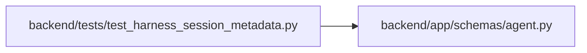

# test_harness_session_metadata Module

**Path:** `backend/tests/test_harness_session_metadata.py`

## Description

A worker may declare the harness session that ran it; the shape is checked, the value is not verified.

## Imports

| Source | Symbols |
|--------|---------|
| `app.schemas.agent` | `AgentRunCreate`, `AgentWorkBegin`, `ModelAwareAgentWorkBegin` |
| `pydantic` | `ValidationError` |
| `pytest` | `pytest` |

## Local dependency map

<!-- Auto-generated local dependency summary. Do not edit by hand. -->

### Internal neighbors

| Direction | Module |
|---|---|
| Outbound | [schemas_agent](../modules/schemas_agent.md) |

### External packages

| Language | Used packages | Undeclared packages |
|---|---:|---:|
| python | 2 | 1 |

## Functions

| Function | Signature | Decorators | Description |
|----------|-----------|------------|-------------|
| `begins` | `(metadata)` | — | — |
| `test_a_declared_harness_session_is_kept_with_the_run_metadata` | `(session_id)` | `@pytest.mark.parametrize('session_id', ['7f3c2a10-5b6e-4d1a-9c2f-0e8b1a2c3d4e', 'thread_01J9ZK'])` | — |
| `test_metadata_without_a_harness_is_unchanged` | `()` | — | — |
| `test_a_malformed_or_secret_harness_is_refused` | `(harness)` | `@pytest.mark.parametrize('harness', ['claude-code:7f3c', {'kind': 'claude-code'}, {'kind': 'claude-code', 'session_id': '7f3c', 'path': '/home/me/.claude'}, {'kind': 'Claude Code', 'session_id': '7f3c'}, {'kind': 'claude-code', 'session_id': ''}, {'kind': 'claude-code', 'session_id': '/home/me/.claude/projects/x/7f3c.jsonl'}, {'kind': 'claude-code', 'session_id': 'C:\\\\Users\\\\me\\\\session'}, {'kind': 'claude-code', 'session_id': 'x' * 256}, {'kind': 'claude-code', 'session_id': 'pmag_' + 'a' * 40}])` | — |
