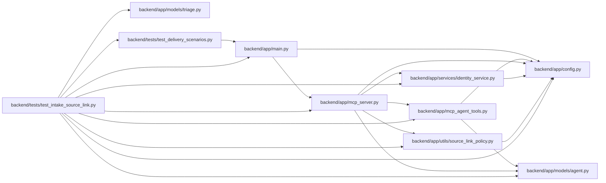

# test_intake_source_link Module

**Path:** `backend/tests/test_intake_source_link.py`

## Description

Source links on intakes and tasks follow one policy.

## Imports

| Source | Symbols |
|--------|---------|
| `app` | `mcp_agent_tools` |
| `app.config` | `get_settings` |
| `app.main` | `app` |
| `app.mcp_server` | `_structured_tool_error` |
| `app.models.agent` | `AgentActor` |
| `app.models.triage` | `TriageItem` |
| `app.services.identity_service` | `IdentityService` |
| `app.utils.source_link_policy` | `SOURCE_LINK_ERROR_CODE`, `SourceLinkRefused`, `evaluate_source_link`, `normalize_source_link` |
| `httpx` | `httpx` |
| `json` | `json` |
| `pytest` | `pytest` |
| `tests.test_delivery_scenarios` | `delivery_store` |

## Local dependency map

<!-- Auto-generated local dependency summary. Do not edit by hand. -->

### Internal neighbors

| Direction | Module |
|---|---|
| Outbound | [config](../modules/config.md) |
| Outbound | [app_main](../modules/app_main.md) |
| Outbound | [mcp_agent_tools](../modules/mcp_agent_tools.md) |
| Outbound | [mcp_server](../modules/mcp_server.md) |
| Outbound | [models_agent](../modules/models_agent.md) |
| Outbound | [models_triage](../modules/models_triage.md) |
| Outbound | [identity_service](../modules/identity_service.md) |
| Outbound | [source_link_policy](../modules/source_link_policy.md) |
| Outbound | [test_delivery_scenarios](../modules/test_delivery_scenarios.md) |

### External packages

| Language | Used packages | Undeclared packages |
|---|---:|---:|
| python | 2 | 1 |

## Functions

| Function | Signature | Decorators | Description |
|----------|-----------|------------|-------------|
| `test_policy_decisions` | `(raw, action, value)` | `@pytest.mark.parametrize(('raw', 'action', 'value'), [(None, 'none', None), ('  ', 'none', None), ('https://example.com/issues/1', 'kept', 'https://example.com/issues/1'), ('/tasks?project=6', 'kept', '/tasks?project=6'), (LOOPBACK, 'rewritten', '/tasks?project=6&iteration=9'), ('http://localhost:3000', 'rewritten', '/'), ('http://[::1]:8480/triage#top', 'rewritten', '/triage#top'), (PRIVATE, 'dropped', None), ('http://169.254.169.254/latest', 'dropped', None), ('//evil.example/x', 'dropped', None), ('ftp://example.com/file', 'dropped', None), ('http://user:pw@127.0.0.1/x', 'dropped', None)])` | — |
| `test_configured_public_address_is_the_same_instance` | `(monkeypatch)` | — | — |
| `test_normalize_names_the_field_and_next_step` | `()` | — | — |
| `_legacy_intake` | *(async)* `(factory, scenario, link)` | — | An intake stored before the policy, holding a link that is now refused. |
| `test_rest_create_and_edit_refuse_with_named_error` | *(async)* `(delivery_store)` | — | — |
| `test_mcp_create_refuses_with_named_error` | *(async)* `(delivery_store)` | — | — |
| `test_loopback_link_converts_to_task_as_relative_path` | *(async)* `(delivery_store)` | — | — |
| `test_private_link_is_dropped_on_conversion_to_task` | *(async)* `(delivery_store)` | — | — |
| `test_link_policy_applies_to_backlog_conversion` | *(async)* `(delivery_store, link, action)` | `@pytest.mark.parametrize(('link', 'action'), [(LOOPBACK, 'rewritten'), (PRIVATE, 'dropped')])` | — |
| `test_legacy_intake_stays_editable_and_a_public_link_is_unchanged` | *(async)* `(delivery_store)` | — | — |
| `test_same_instance_link_with_unsafe_path_is_dropped` | `(raw)` | `@pytest.mark.parametrize('raw', UNSAFE_REWRITES)` | — |
| `test_policy_is_idempotent` | `(raw)` | `@pytest.mark.parametrize('raw', [LOOPBACK, 'http://localhost:3000', '/tasks?project=6', 'https://example.com/a', 'http://[::1]/triage#top'])` | — |
| `test_legacy_unsafe_value_converts_instead_of_failing` | *(async)* `(delivery_store, link, route)` | `@pytest.mark.parametrize('link', UNSAFE_REWRITES)`, `@pytest.mark.parametrize('route', ['convert-to-task', 'convert-to-backlog'])` | — |
