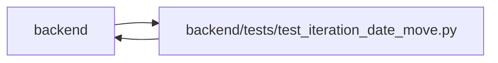

# test_iteration_date_move Module

**Path:** `backend/tests/test_iteration_date_move.py`

## Description

A proposed iteration period is checked against each person's bookings elsewhere and saves nothing.

## Imports

| Source | Symbols |
|--------|---------|
| `app` | `database`, `mcp_server` |
| `app.config` | `get_settings` |
| `app.main` | `app` |
| `app.models.calendar` | `Calendar` |
| `app.models.capacity` | `PlanningState` |
| `app.models.identity` | `CommandAudit`, `IdentitySubject`, `Principal`, `ProjectMembership`, `WorkspaceMembership` |
| `app.models.iteration` | `Iteration` |
| `app.models.project` | `Project` |
| `app.models.recovery` | `ApplicationSnapshot` |
| `app.models.task` | `Task` |
| `app.models.team_member` | `TeamMemberCapacityAdjustment` |
| `app.models.user_session` | `UserSession` |
| `app.services.agent_service` | `hash_api_key` |
| `app.services.identity_service` | `IdentityService`, `digest`, `initialize_control_plane` |
| `app.utils.time` | `utc_now` |
| `contextlib` | `asynccontextmanager` |
| `datetime` | `date`, `timedelta` |
| `httpx` | `httpx` |
| `json` | `json` |
| `pytest` | `pytest` |
| `sqlalchemy` | `func`, `select` |
| `tests.test_review_provenance` | `database_engines` |
| `tests.test_team_pm_dispatch` | `db_session_factory` |

## Local dependency map

<!-- Auto-generated local dependency summary. Do not edit by hand. -->

> Module-level dependencies exceed the generated-diagram limits, so the diagram and table below group them by top-level package. Counts report the number of module neighbors in each package.

### Internal neighbors

| Direction | Module |
|---|---|
| Inbound | `backend` (2) |
| Outbound | `backend` (18) |

### External packages

| Language | Used packages | Undeclared packages |
|---|---:|---:|
| python | 3 | 1 |

> All 20 module neighbor(s) are summarized by package because the module-level view exceeds the 12-node limit.

## Functions

| Function | Signature | Decorators | Description |
|----------|-----------|------------|-------------|
| `restore_settings_cache` | `()` | `@pytest.fixture(autouse=True)` | — |
| `managed` | *(async)* `(db, db_session_factory, monkeypatch)` | — | — |
| `staffed_iteration` | *(async)* `(db, profile_factory, team_member_factory)` | — | Ten agent profiles staff a later Pi iteration; nine are fully booked by another project in November. |
| `proposal` | `(scenario, **extra)` | — | — |
| `human` | *(async)* `(db, project_roles, *, workspace_member = True)` | — | A signed-in person with the given project roles; returns a cookie client factory. |
| `operator` | *(async)* `()` | `@asynccontextmanager` | — |
| `persisted_state` | *(async)* `(factory, scenario)` | — | — |
| `assert_pi_shortfalls` | `(body, scenario)` | — | — |
| `test_rest_preview_reports_each_booked_profile_and_apply_is_fenced` | *(async)* `(db_session, db_session_factory, profile_factory, team_member_factory, monkeypatch)` | `@database_engines` | — |
| `test_preview_requires_edit_permission_on_the_iteration` | *(async)* `(db_session, db_session_factory, profile_factory, team_member_factory, monkeypatch)` | `@database_engines` | — |
| `test_mcp_preview_then_update_with_returned_revisions` | *(async)* `(db_session, db_session_factory, profile_factory, team_member_factory, actor_factory, monkeypatch)` | `@database_engines` | — |
