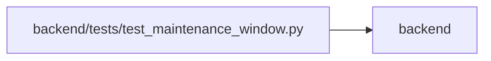

# test_maintenance_window Module

**Path:** `backend/tests/test_maintenance_window.py`

## Description

A coordinated maintenance window protects only the live claims whose owners acknowledged it.

## Imports

| Source | Symbols |
|--------|---------|
| `alembic` | `command` |
| `app.config` | `get_settings` |
| `app.models.agent` | `AgentActor`, `AgentTaskAssignment` |
| `app.models.identity` | `Principal`, `WorkspaceAuthorityState` |
| `app.models.maintenance` | `MaintenanceWindow` |
| `app.models.task` | `Task` |
| `app.services` | `agent_work_service`, `backlog_snapshot_service`, `work_metrics` |
| `app.services.agent_service` | `hash_api_key` |
| `app.services.upgrade_service` | `alembic_config` |
| `app.utils` | `time` |
| `datetime` | `date`, `timedelta` |
| `pytest` | `pytest` |
| `sqlalchemy` | `create_engine`, `inspect`, `select` |
| `tests.test_delivery_scenarios` | `delivery_store` |
| `tests.test_schedule_follows_actual_dates` | `NOW`, `_client`, `_headers`, `_seed` |

## Local dependency map

<!-- Auto-generated local dependency summary. Do not edit by hand. -->

> Module-level dependencies exceed the generated-diagram limits, so the diagram and table below group them by top-level package. Counts report the number of module neighbors in each package.

### Internal neighbors

| Direction | Module |
|---|---|
| Outbound | `backend` (13) |

### External packages

| Language | Used packages | Undeclared packages |
|---|---:|---:|
| python | 3 | 1 |

> All 13 module neighbor(s) are summarized by package because the module-level view exceeds the 12-node limit.

## Functions

| Function | Signature | Decorators | Description |
|----------|-----------|------------|-------------|
| `clock` | `(monkeypatch)` | `@pytest.fixture` | A clock the test moves forward explicitly; nothing advances by itself. |
| `operator_key` | `(monkeypatch)` | `@pytest.fixture` | — |
| `_store` | *(async)* `(factory, scenario, tasks = ('first',))` | — | — |
| `_window_body` | `(**overrides)` | — | — |
| `_begin_work` | *(async)* `(client, scenario, assignment_id, key, lease_seconds)` | — | — |
| `_renew` | *(async)* `(client, scenario, receipt, key, lease_seconds)` | — | — |
| `_codes` | `(response)` | — | — |
| `test_an_acknowledged_worker_renews_and_finishes_across_the_window` | *(async)* `(delivery_store, clock, operator_key)` | — | — |
| `test_a_long_lease_and_a_quiet_worker_are_not_consent` | *(async)* `(delivery_store, clock, operator_key)` | — | — |
| `test_an_expired_lease_on_a_running_run_blocks_the_window` | *(async)* `(delivery_store, clock, operator_key)` | — | — |
| `test_downgrade_refuses_an_open_window` | `(tmp_path, configure_database)` | `@pytest.mark.sqlite` | — |
