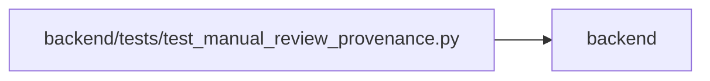

# test_manual_review_provenance Module

**Path:** `backend/tests/test_manual_review_provenance.py`

## Description

Authenticated human delivery still requires an assigned agent decision in a strict project.

## Imports

| Source | Symbols |
|--------|---------|
| `app.config` | `get_settings` |
| `app.main` | `app` |
| `app.models.agent` | `AgentModelCatalogEntry`, `AgentRun`, `AgentTaskAssignment`, `TaskEvent` |
| `app.models.identity` | `IdentitySubject`, `Principal`, `PrincipalProfileLink`, `ProjectMembership`, `WorkspaceMembership` |
| `app.models.iteration` | `Iteration` |
| `app.models.project` | `Project` |
| `app.models.task` | `Task` |
| `app.models.task_brief` | `TaskProgressRecord` |
| `app.models.user_session` | `UserSession` |
| `app.services.agent_routing_policy` | `RoutingProfileEvidence`, `evaluate_assignment_compatibility` |
| `app.services.github_status_service` | `GitHubStatusService` |
| `app.services.identity_service` | `IdentityService`, `digest`, `initialize_control_plane` |
| `app.services.review_provenance` | `review_history` |
| `app.utils.time` | `utc_now` |
| `datetime` | `timedelta` |
| `httpx` | `httpx` |
| `pytest` | `pytest` |
| `sqlalchemy` | `select` |
| `tests.test_agent_team_setup_qualification` | `provision_ready_topology`, `routing_base` |
| `tests.test_review_provenance_transports` | `databases` |
| `tests.test_team_pm_dispatch` | `db_session_factory` |
| `tests.test_team_pm_recovery` | `recovery_api` |

## Local dependency map

<!-- Auto-generated local dependency summary. Do not edit by hand. -->

> Module-level dependencies exceed the generated-diagram limits, so the diagram and table below group them by top-level package. Counts report the number of module neighbors in each package.

### Internal neighbors

| Direction | Module |
|---|---|
| Outbound | `backend` (18) |

### External packages

| Language | Used packages | Undeclared packages |
|---|---:|---:|
| python | 3 | 1 |

> All 18 module neighbor(s) are summarized by package because the module-level view exceeds the 12-node limit.

## Functions

| Function | Signature | Decorators | Description |
|----------|-----------|------------|-------------|
| `test_authenticated_manual_submission_and_assigned_agent_verdict` | *(async)* `(db_session, db_session_factory, task_factory, team_member_factory, profile_factory, monkeypatch, transport, delivery)` | `@databases`, `@pytest.mark.parametrize(('transport', 'delivery'), [('rest', 'document'), ('mcp', 'repository'), ('rest', 'coauthored'), ('mcp', 'missing_artifact')])`, `@pytest.mark.usefixtures('deployed_agent_skill_release')` | — |
| `test_unconfirmed_manual_work_stays_held` | *(async)* `(db_session, db_session_factory, task_factory, actor_factory)` | `@databases` | — |
| `test_verifier_preview_keeps_the_authenticated_humans_profile_independent` | `()` | `@pytest.mark.sqlite` | — |
