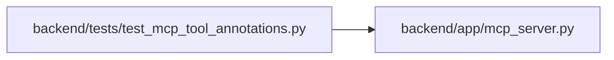

# test_mcp_tool_annotations Module

**Path:** `backend/tests/test_mcp_tool_annotations.py`

## Description

Every MCP tool tells clients whether it reads, writes, or removes.

A client running with nobody to approve calls refuses a tool it has to assume
is destructive, so a tool that declares nothing is unusable there.

## Imports

| Source | Symbols |
|--------|---------|
| `__future__` | `annotations` |
| `app.mcp_server` | `mcp` |
| `pytest` | `pytest` |
| `re` | `re` |

## Local dependency map

<!-- Auto-generated local dependency summary. Do not edit by hand. -->

### Internal neighbors

| Direction | Module |
|---|---|
| Outbound | [mcp_server](../modules/mcp_server.md) |

### External packages

| Language | Used packages | Undeclared packages |
|---|---:|---:|
| python | 1 | 1 |

## Functions

| Function | Signature | Decorators | Description |
|----------|-----------|------------|-------------|
| `needs_approval` | `(annotations) -> bool` | — | The rule unattended clients apply: an unset hint counts as the unsafe value. |
| `tools` | *(async)* `()` | `@pytest.fixture` | — |
| `test_every_tool_declares_how_it_behaves` | *(async)* `(tools) -> None` | — | — |
| `test_read_tools_are_declared_read_only_and_nothing_else_is` | *(async)* `(tools) -> None` | — | — |
| `test_only_tools_that_remove_a_record_are_declared_destructive` | *(async)* `(tools) -> None` | — | — |
| `test_an_unattended_client_can_run_everything_except_removals` | *(async)* `(tools) -> None` | — | — |
| `test_annotations_reach_the_wire_format` | *(async)* `(tools) -> None` | — | — |
