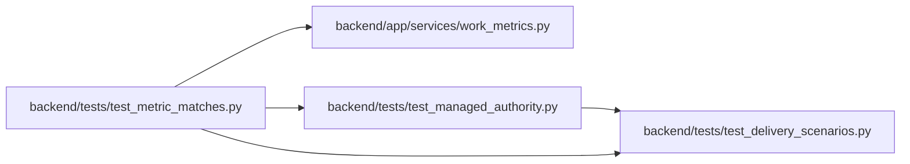

# test_metric_matches Module

**Path:** `backend/tests/test_metric_matches.py`

## Description

A work-metric count and the list it opens are chosen by the same predicate.

## Imports

| Source | Symbols |
|--------|---------|
| `app.services.work_metrics` | `METRIC_MATCHES`, `aggregate_metrics` |
| `tests.test_delivery_scenarios` | `delivery_store` |
| `tests.test_managed_authority` | `client` |

## Local dependency map

<!-- Auto-generated local dependency summary. Do not edit by hand. -->

### Internal neighbors

| Direction | Module |
|---|---|
| Outbound | [services_work_metrics](../modules/services_work_metrics.md) |
| Outbound | [test_delivery_scenarios](../modules/test_delivery_scenarios.md) |
| Outbound | [test_managed_authority](../modules/test_managed_authority.md) |

## Functions

| Function | Signature | Decorators | Description |
|----------|-----------|------------|-------------|
| `expected` | `(counts, metric)` | — | — |
| `test_every_metric_list_has_as_many_tasks_as_its_count` | *(async)* `(delivery_store)` | — | — |
| `test_metric_matches_route_scopes_and_rejects_unknown_metrics` | *(async)* `(delivery_store)` | — | — |
