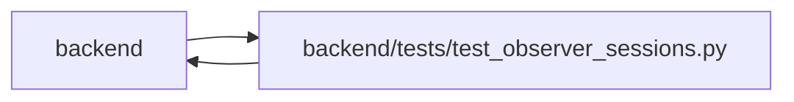

# test_observer_sessions Module

**Path:** `backend/tests/test_observer_sessions.py`

## Description

Paired observer sessions read like their principal, change nothing, and renew within a cap.

## Imports

| Source | Symbols |
|--------|---------|
| `app.config` | `Settings`, `get_settings` |
| `app.models.user_session` | `UserSession` |
| `app.services.identity_service` | `digest` |
| `app.utils.time` | `as_utc`, `utc_now` |
| `base64` | `base64` |
| `datetime` | `timedelta` |
| `hashlib` | `hashlib` |
| `pydantic` | `ValidationError` |
| `pytest` | `pytest` |
| `pytest_asyncio` | `pytest_asyncio` |
| `sqlalchemy` | `func`, `select` |
| `tests.test_delivery_scenarios` | `delivery_store` |
| `tests.test_managed_authority` | `client`, `managed_store` |

## Local dependency map

<!-- Auto-generated local dependency summary. Do not edit by hand. -->

> Module-level dependencies exceed the generated-diagram limits, so the diagram and table below group them by top-level package. Counts report the number of module neighbors in each package.

### Internal neighbors

| Direction | Module |
|---|---|
| Inbound | `backend` (6) |
| Outbound | `backend` (6) |

### External packages

| Language | Used packages | Undeclared packages |
|---|---:|---:|
| python | 4 | 2 |

> All 12 module neighbor(s) are summarized by package because the module-level view exceeds the 12-node limit.

## Functions

| Function | Signature | Decorators | Description |
|----------|-----------|------------|-------------|
| `local_store` | *(async)* `(delivery_store, monkeypatch)` | `@pytest_asyncio.fixture` | — |
| `bearer` | `(token)` | — | — |
| `start` | *(async)* `(access = 'observe', label = 'Desk reader')` | — | — |
| `exchange` | *(async)* `(connection)` | — | — |
| `approve_with` | *(async)* `(browser, connection, label = 'Desk reader')` | — | — |
| `pair_managed` | *(async)* `(token, csrf, label = 'Desk reader')` | — | — |
| `session_row` | *(async)* `(factory, token)` | — | — |
| `move_sign_in` | *(async)* `(factory, token, *, ago)` | — | — |
| `session_count` | *(async)* `(factory)` | — | — |
| `assert_read_only` | `(response)` | — | — |
| `test_managed_observer_reads_as_its_person_and_changes_nothing` | *(async)* `(managed_store)` | — | — |
| `test_observer_cannot_approve_pairings_or_travel_with_another_credential` | *(async)* `(managed_store)` | — | — |
| `test_observer_renewal_rotates_never_upgrades_and_stops_at_the_cap` | *(async)* `(managed_store)` | — | — |
| `test_person_renewal_keeps_the_sign_in_time_and_rotates_bearers` | *(async)* `(managed_store)` | — | — |
| `test_signed_in_cookie_rotation_shares_the_renewal_cap` | *(async)* `(managed_store)` | — | — |
| `test_trusted_local_pairs_observers_from_its_browser_and_can_revoke_them` | *(async)* `(local_store)` | — | — |
| `test_a_local_observer_stops_working_when_the_workspace_becomes_managed` | *(async)* `(local_store, monkeypatch)` | — | — |
| `test_renewal_caps_cannot_be_shorter_than_one_session` | `()` | — | — |
