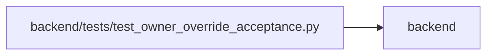

# test_owner_override_acceptance Module

**Path:** `backend/tests/test_owner_override_acceptance.py`

## Description

An owner may accept one resolved task while the different-publisher policy stays on.

## Imports

| Source | Symbols |
|--------|---------|
| `app.authority` | `Authority`, `AuthorityError` |
| `app.commands` | `command_transaction` |
| `app.models.agent` | `TaskEvent` |
| `app.models.identity` | `CommandAudit`, `ProjectMembership`, `WorkspaceMembership` |
| `app.models.project` | `Project` |
| `app.models.task` | `Task` |
| `app.models.task_brief` | `TaskReviewRecord` |
| `app.schemas.task_brief` | `BriefCriterion`, `OwnerAcceptanceWrite`, `TaskBrief` |
| `app.services.manual_provenance_service` | `MAX_RECORDS` |
| `app.services.task_brief_service` | `TaskBriefService` |
| `app.services.task_service` | `TaskService` |
| `json` | `json` |
| `pytest` | `pytest` |
| `sqlalchemy` | `select`, `update` |
| `tests.test_delivery_scenarios` | `delivery_store` |
| `tests.test_managed_authority` | `client`, `managed_store` |

## Local dependency map

<!-- Auto-generated local dependency summary. Do not edit by hand. -->

> Module-level dependencies exceed the generated-diagram limits, so the diagram and table below group them by top-level package. Counts report the number of module neighbors in each package.

### Internal neighbors

| Direction | Module |
|---|---|
| Outbound | `backend` (13) |

### External packages

| Language | Used packages | Undeclared packages |
|---|---:|---:|
| python | 2 | 1 |

> All 13 module neighbor(s) are summarized by package because the module-level view exceeds the 12-node limit.

## Functions

| Function | Signature | Decorators | Description |
|----------|-----------|------------|-------------|
| `policy_scope` | *(async)* `(managed_store, role = 'owner')` | — | Turn the policy on for the first project and add a second resolved task there. |
| `owner_client` | `(managed_store, index = 0, **headers)` | — | — |
| `acceptance_body` | *(async)* `(factory, task_id, reason = REASON)` | — | — |
| `test_owner_override_accepts_one_task_and_keeps_the_policy_for_the_rest` | *(async)* `(managed_store, role)` | `@pytest.mark.parametrize('role', ['owner', 'operator'])` | — |
| `test_override_refuses_non_owners_missing_reasons_and_unpoliced_projects` | *(async)* `(managed_store)` | — | — |
| `test_review_override_header_waives_only_self_review_on_an_owner_override` | *(async)* `(managed_store)` | — | — |
| `test_trusted_local_browser_without_a_signed_in_person_cannot_override` | *(async)* `(delivery_store)` | — | — |
| `test_only_a_signed_in_owner_or_operator_may_override` | *(async)* `(delivery_store, authority)` | `@pytest.mark.parametrize('authority', [Authority(None, 'local', local=True), Authority(1, 'system', workspace_role='operator', review_override=True, reason=REASON), Authority(None, 'agent', actor_id=1, actor_role='verifier', local=True, scopes=frozenset({'admin'})), Authority(1, 'human', workspace_role='owner', read_only=True), Authority(1, 'human', workspace_role='member', projects={1: 'manager'})], ids=['trusted-local', 'operator-key', 'agent', 'observer', 'project-manager'])` | — |
| `test_override_grant_covers_only_its_task_revision_and_acceptance` | *(async)* `(delivery_store)` | — | — |
| `test_the_refusal_and_the_task_actions_name_the_owner_acceptance_next_step` | *(async)* `(managed_store)` | — | — |
| `test_the_actions_say_whether_a_provenance_record_would_be_accepted` | *(async)* `(managed_store)` | — | — |
| `test_the_actions_refuse_a_provenance_record_past_the_record_limit` | *(async)* `(managed_store)` | — | — |
