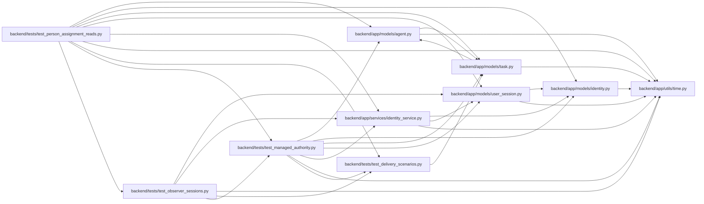

# test_person_assignment_reads Module

**Path:** `backend/tests/test_person_assignment_reads.py`

## Description

People read the assignments of tasks they can see; agent keys keep the full projection.

## Imports

| Source | Symbols |
|--------|---------|
| `app.models.agent` | `AgentActor`, `AgentModelBinding`, `AgentModelCatalogEntry`, `AgentTaskAssignment` |
| `app.models.identity` | `Principal` |
| `app.models.task` | `Task` |
| `app.models.user_session` | `UserSession` |
| `app.services.identity_service` | `digest` |
| `app.utils.time` | `utc_now` |
| `datetime` | `timedelta` |
| `json` | `json` |
| `tests.test_delivery_scenarios` | `delivery_store` |
| `tests.test_managed_authority` | `client`, `managed_store` |
| `tests.test_observer_sessions` | `bearer`, `local_store`, `pair_managed` |

## Local dependency map

<!-- Auto-generated local dependency summary. Do not edit by hand. -->

### Internal neighbors

| Direction | Module |
|---|---|
| Outbound | [models_agent](../modules/models_agent.md) |
| Outbound | [models_identity](../modules/models_identity.md) |
| Outbound | [models_task](../modules/models_task.md) |
| Outbound | [user_session](../modules/user_session.md) |
| Outbound | [identity_service](../modules/identity_service.md) |
| Outbound | [time](../modules/time.md) |
| Outbound | [test_delivery_scenarios](../modules/test_delivery_scenarios.md) |
| Outbound | [test_managed_authority](../modules/test_managed_authority.md) |
| Outbound | [test_observer_sessions](../modules/test_observer_sessions.md) |

## Functions

| Function | Signature | Decorators | Description |
|----------|-----------|------------|-------------|
| `seed_assignments` | *(async)* `(factory, scenario)` | — | — |
| `assignments` | *(async)* `(response)` | — | — |
| `test_a_person_reads_assignments_of_visible_tasks_without_routing_evidence` | *(async)* `(managed_store)` | — | — |
| `test_a_person_without_any_work_cannot_list_assignments` | *(async)* `(managed_store)` | — | — |
| `test_an_agent_key_keeps_the_full_projection` | *(async)* `(managed_store)` | — | — |
| `test_an_observer_reads_the_assignments_its_person_can_read` | *(async)* `(managed_store)` | — | — |
| `test_a_trusted_local_browser_reads_every_assignment` | *(async)* `(local_store)` | — | — |
