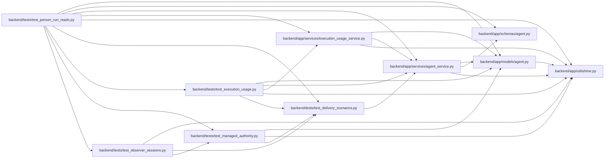

# test_person_run_reads Module

**Path:** `backend/tests/test_person_run_reads.py`

## Description

People read the runs of tasks they can see; run logs stay behind keys.

## Imports

| Source | Symbols |
|--------|---------|
| `app.models.agent` | `AgentActor`, `AgentRun` |
| `app.schemas.agent` | `AgentRunCreate`, `declared_harness` |
| `app.services.agent_service` | `AgentService` |
| `app.services.execution_usage_service` | `ExecutionUsageService` |
| `app.utils.time` | `utc_now` |
| `datetime` | `timedelta` |
| `importlib` | `importlib` |
| `json` | `json` |
| `tests.test_delivery_scenarios` | `delivery_store` |
| `tests.test_execution_usage` | `usage` |
| `tests.test_managed_authority` | `client`, `managed_store` |
| `tests.test_observer_sessions` | `bearer`, `local_store`, `pair_managed` |

## Local dependency map

<!-- Auto-generated local dependency summary. Do not edit by hand. -->

### Internal neighbors

| Direction | Module |
|---|---|
| Outbound | [models_agent](../modules/models_agent.md) |
| Outbound | [schemas_agent](../modules/schemas_agent.md) |
| Outbound | [agent_service](../modules/agent_service.md) |
| Outbound | [execution_usage_service](../modules/execution_usage_service.md) |
| Outbound | [time](../modules/time.md) |
| Outbound | [test_delivery_scenarios](../modules/test_delivery_scenarios.md) |
| Outbound | [test_execution_usage](../modules/test_execution_usage.md) |
| Outbound | [test_managed_authority](../modules/test_managed_authority.md) |
| Outbound | [test_observer_sessions](../modules/test_observer_sessions.md) |

## Functions

| Function | Signature | Decorators | Description |
|----------|-----------|------------|-------------|
| `seed_runs` | *(async)* `(factory, scenario)` | — | — |
| `runs` | *(async)* `(response)` | — | — |
| `test_a_person_reads_runs_of_visible_tasks_without_logs` | *(async)* `(managed_store)` | — | — |
| `test_an_observer_reads_runs_and_anonymous_callers_cannot` | *(async)* `(managed_store)` | — | — |
| `test_an_agent_key_needs_planning_read` | *(async)* `(managed_store)` | — | — |
| `test_a_trusted_local_browser_reads_every_run_and_filters` | *(async)* `(local_store)` | — | — |
| `test_the_declared_harness_is_read_from_validated_metadata` | `()` | — | — |
| `test_the_migration_backfills_only_valid_declarations` | `()` | — | — |
| `test_a_started_run_keeps_its_declared_harness_session` | *(async)* `(local_store)` | — | — |
