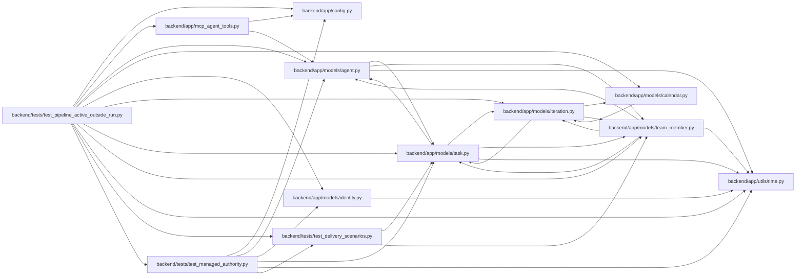

# test_pipeline_active_outside_run Module

**Path:** `backend/tests/test_pipeline_active_outside_run.py`

## Description

Active work with no WorkChord run is shown in its own pipeline stage.

## Imports

| Source | Symbols |
|--------|---------|
| `app` | `mcp_agent_tools` |
| `app.config` | `get_settings` |
| `app.models.agent` | `AgentActor`, `AgentRun`, `AgentTaskAssignment` |
| `app.models.calendar` | `Calendar` |
| `app.models.identity` | `Principal`, `WorkspaceAuthorityState` |
| `app.models.iteration` | `Iteration` |
| `app.models.task` | `Task` |
| `app.models.team_member` | `TeamMember`, `TeamMemberProfile` |
| `app.utils.time` | `utc_now` |
| `datetime` | `date`, `timedelta` |
| `json` | `json` |
| `sqlalchemy` | `select` |
| `tests.test_delivery_scenarios` | `delivery_store` |
| `tests.test_managed_authority` | `client` |

## Local dependency map

<!-- Auto-generated local dependency summary. Do not edit by hand. -->

### Internal neighbors

| Direction | Module |
|---|---|
| Outbound | [config](../modules/config.md) |
| Outbound | [mcp_agent_tools](../modules/mcp_agent_tools.md) |
| Outbound | [models_agent](../modules/models_agent.md) |
| Outbound | [models_calendar](../modules/models_calendar.md) |
| Outbound | [models_identity](../modules/models_identity.md) |
| Outbound | [models_iteration](../modules/models_iteration.md) |
| Outbound | [models_task](../modules/models_task.md) |
| Outbound | [team_member](../modules/team_member.md) |
| Outbound | [time](../modules/time.md) |
| Outbound | [test_delivery_scenarios](../modules/test_delivery_scenarios.md) |
| Outbound | [test_managed_authority](../modules/test_managed_authority.md) |

### External packages

| Language | Used packages | Undeclared packages |
|---|---:|---:|
| python | 1 | 0 |

## Functions

| Function | Signature | Decorators | Description |
|----------|-----------|------------|-------------|
| `seed` | *(async)* `(factory)` | — | — |
| `stage_of` | `(pipeline, task_id)` | — | — |
| `test_active_task_without_a_run_is_its_own_stage_on_rest_and_mcp` | *(async)* `(delivery_store, monkeypatch)` | — | — |
| `test_every_open_task_appears_in_exactly_one_stage` | *(async)* `(delivery_store)` | — | — |
| `test_outside_run_task_is_not_offered_for_recovery` | *(async)* `(delivery_store)` | — | — |
