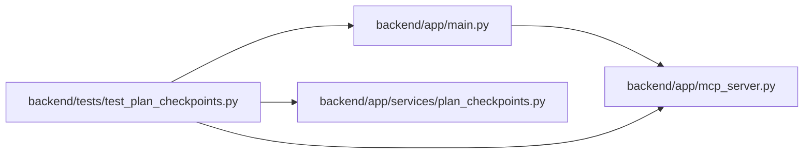

# test_plan_checkpoints Module

**Path:** `backend/tests/test_plan_checkpoints.py`

## Description

People and the PM read the same six plan checkpoints from the server.

## Imports

| Source | Symbols |
|--------|---------|
| `__future__` | `annotations` |
| `app.main` | `app` |
| `app.mcp_server` | `mcp` |
| `app.services.plan_checkpoints` | `PLAN_CHECKPOINT_IDS`, `plan_checkpoints` |
| `pytest` | `pytest` |

## Local dependency map

<!-- Auto-generated local dependency summary. Do not edit by hand. -->

### Internal neighbors

| Direction | Module |
|---|---|
| Outbound | [app_main](../modules/app_main.md) |
| Outbound | [mcp_server](../modules/mcp_server.md) |
| Outbound | [plan_checkpoints](../modules/plan_checkpoints.md) |

### External packages

| Language | Used packages | Undeclared packages |
|---|---:|---:|
| python | 1 | 1 |

## Functions

| Function | Signature | Decorators | Description |
|----------|-----------|------------|-------------|
| `_states` | `(**overrides)` | — | — |
| `test_checkpoints_follow_the_plan_page_order` | `() -> None` | — | — |
| `test_an_empty_iteration_starts_with_people_and_work` | `() -> None` | — | — |
| `test_blockers_name_what_is_missing_and_hold_the_schedule` | `() -> None` | — | — |
| `test_single_gaps_mark_one_checkpoint` | `(overrides, checkpoint, state) -> None` | `@pytest.mark.parametrize(('overrides', 'checkpoint', 'state'), [({'team_members_no_capacity': 1}, 'team', 'warn'), ({'has_schedule': False}, 'schedule', 'todo'), ({'risk_count': 2}, 'review', 'warn')])` | — |
| `test_agents_can_read_plan_readiness_over_rest_and_mcp` | *(async)* `() -> None` | `@pytest.mark.asyncio` | — |
| `test_agent_held_work_is_reported_apart_from_unassigned` | `() -> None` | — | — |
