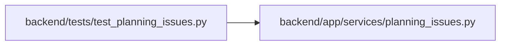

# test_planning_issues Module

**Path:** `backend/tests/test_planning_issues.py`

## Description

The "needs an assignee" and "missing effort" rule shared by counts and filters.

## Imports

| Source | Symbols |
|--------|---------|
| `__future__` | `annotations` |
| `app.services.planning_issues` | `agent_working_without_capacity`, `missing_effort`, `needs_assignee` |
| `pytest` | `pytest` |
| `types` | `SimpleNamespace` |

## Local dependency map

<!-- Auto-generated local dependency summary. Do not edit by hand. -->

### Internal neighbors

| Direction | Module |
|---|---|
| Outbound | [planning_issues](../modules/planning_issues.md) |

### External packages

| Language | Used packages | Undeclared packages |
|---|---:|---:|
| python | 1 | 1 |

## Functions

| Function | Signature | Decorators | Description |
|----------|-----------|------------|-------------|
| `_task` | `(**overrides)` | — | — |
| `test_planned_leaf_without_assignee_needs_one` | `() -> None` | — | — |
| `test_started_or_finished_work_is_not_a_scheduling_gap` | `(status) -> None` | `@pytest.mark.parametrize('status', ['active', 'resolved', 'closed'])` | — |
| `test_deferred_and_parent_tasks_are_excluded` | `(overrides) -> None` | `@pytest.mark.parametrize('overrides', [{'is_deferred': True}, {'effective_is_deferred': True}, {'is_composite': True}, {'children': [object()]}])` | — |
| `test_agent_held_work_is_not_unassigned` | `() -> None` | — | — |
| `test_missing_effort` | `(effort) -> None` | `@pytest.mark.parametrize('effort', [None, 0, -1, float('nan'), True])` | — |
