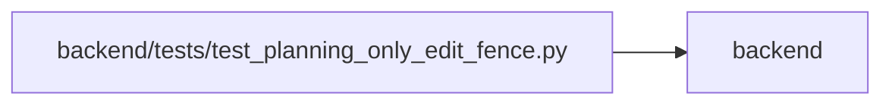

# test_planning_only_edit_fence Module

**Path:** `backend/tests/test_planning_only_edit_fence.py`

## Description

A planning-only task edit keeps sealed issued work valid; an execution-input edit still stales it.

## Imports

| Source | Symbols |
|--------|---------|
| `app.authority` | `Authority`, `Authority`, `Authority`, `Authority` |
| `app.commands` | `command_transaction`, `command_transaction`, `command_transaction`, `command_transaction` |
| `app.config` | `get_settings` |
| `app.main` | `app` |
| `app.models.agent` | `AgentModelCatalogEntry`, `AgentRun`, `AgentTaskAssignment`, `TaskEvent` |
| `app.models.delivery_dependency` | `DeliveryDependency`, `DeliveryDependency` |
| `app.models.identity` | `Principal`, `ProjectMembership`, `WorkspaceMembership` |
| `app.models.iteration` | `Iteration` |
| `app.models.project` | `Project`, `ProjectMilestone` |
| `app.models.task` | `Task`, `TaskDependency` |
| `app.routers.tasks` | `apply_batch_update_items` |
| `app.schemas.task` | `TaskUpdate`, `TaskBatchUpdateItem`, `TaskUpdate`, `TaskUpdate` |
| `app.schemas.task_brief` | `TaskReviewWrite` |
| `app.services.agent_work_service` | `AgentWorkService` |
| `app.services.delivery_dependency_service` | `DeliveryDependencyService`, `DeliveryDependencyService` |
| `app.services.execution_planning_window` | `ITERATION_END_EXTENSION`, `PLANNING_ONLY_EDIT`, `PLANNING_ONLY_FIELDS`, `current_window`, `is_planning_only_change` |
| `app.services.identity_service` | `IdentityService`, `initialize_control_plane` |
| `app.services.task_brief_service` | `TaskBriefService` |
| `app.services.task_service` | `TaskService`, `TaskService`, `TaskService` |
| `app.utils.time` | `utc_now` |
| `datetime` | `timedelta` |
| `httpx` | `httpx` |
| `json` | `json` |
| `pytest` | `pytest` |
| `sqlalchemy` | `select` |
| `tests` | `test_team_pm_dispatch` |
| `tests.test_agent_team_setup_qualification` | `provision_ready_topology`, `routing_base` |
| `tests.test_review_provenance_transports` | `databases`, `fence` |
| `tests.test_team_pm_recovery` | `recovery_api` |
| `types` | `SimpleNamespace` |

## Local dependency map

<!-- Auto-generated local dependency summary. Do not edit by hand. -->

> Module-level dependencies exceed the generated-diagram limits, so the diagram and table below group them by top-level package. Counts report the number of module neighbors in each package.

### Internal neighbors

| Direction | Module |
|---|---|
| Outbound | `backend` (24) |

### External packages

| Language | Used packages | Undeclared packages |
|---|---:|---:|
| python | 3 | 1 |

> All 24 module neighbor(s) are summarized by package because the module-level view exceeds the 12-node limit.

## Functions

| Function | Signature | Decorators | Description |
|----------|-----------|------------|-------------|
| `test_planning_only_fields_are_explicit_and_exclude_execution_inputs` | `()` | — | — |
| `team_scope` | *(async)* `(db, task_factory, team_member_factory, *, summary = False)` | — | A ready team, one routed task in a strict-review project with two milestones. |
| `planning_patch` | *(async)* `(http, pm_key, task_id, expected_version, key, **changes)` | — | — |
| `snapshot` | *(async)* `(factory, task_id, assignment_id, run_id = None)` | — | — |
| `test_milestone_change_keeps_issued_work` | *(async)* `(db_session, db_session_factory, task_factory, team_member_factory, monkeypatch, transport, case)` | `@databases`, `@pytest.mark.parametrize('transport', ['rest', 'mcp'])`, `@pytest.mark.parametrize('case', ['running', 'consecutive', 'after_extension', 'queued', 'summary', 'verification', 'rework'])`, `@pytest.mark.usefixtures('deployed_agent_skill_release')` | — |
| `test_execution_input_change_still_stales_running_work` | *(async)* `(db_session, db_session_factory, task_factory, team_member_factory, monkeypatch, change)` | `@databases`, `@pytest.mark.parametrize('change', ['title', 'description', 'assignee', 'depends_on', 'tags', 'priority', 'max_end_date', 'milestone_and_title'])`, `@pytest.mark.usefixtures('deployed_agent_skill_release')` | — |
| `test_one_command_reseals_or_ends_the_fence` | *(async)* `(db_session, db_session_factory, task_factory, team_member_factory, monkeypatch, then)` | `@databases`, `@pytest.mark.parametrize('then', ['milestone', 'depends_on'])`, `@pytest.mark.usefixtures('deployed_agent_skill_release')` | A bulk edit of a summary and its subtask reserves the subtask's version once. |
| `all_work_items` | `(decision)` | — | — |
| `dispatch_and_begin` | *(async)* `(call, s, *, begin = True)` | — | — |
| `test_milestone_change_without_original_receipt_still_stales` | *(async)* `(db_session, db_session_factory, task_factory, team_member_factory, monkeypatch)` | `@databases`, `@pytest.mark.usefixtures('deployed_agent_skill_release')` | — |
| `test_batch_that_changes_a_fenced_task_prerequisite_ends_the_fence` | *(async)* `(db_session, db_session_factory, task_factory, team_member_factory, monkeypatch)` | `@databases`, `@pytest.mark.usefixtures('deployed_agent_skill_release')` | Moving a running task off one milestone and new work into its prerequisite milestone in one batch. |
| `test_later_change_in_the_same_command_ends_the_fence` | *(async)* `(db_session, db_session_factory, task_factory, team_member_factory, monkeypatch, then)` | `@databases`, `@pytest.mark.parametrize('then', ['nothing', 'delivery_edge'])`, `@pytest.mark.usefixtures('deployed_agent_skill_release')` | A change that does not go through a task update still ends a fence sealed earlier in the command. |
| `test_one_command_that_accepts_a_dependency_chain_keeps_acceptance` | *(async)* `(db_session, db_session_factory, task_factory, team_member_factory, monkeypatch, order)` | `@databases`, `@pytest.mark.parametrize('order', ['upstream_first', 'dependent_first'])`, `@pytest.mark.usefixtures('deployed_agent_skill_release')` | Closing a task and the task it waits for in one command keeps both acceptances. |
