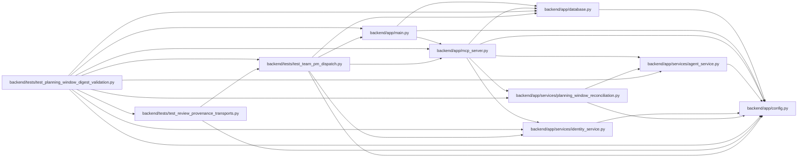

# test_planning_window_digest_validation Module

**Path:** `backend/tests/test_planning_window_digest_validation.py`

## Description

Malformed evidence digests get the same refusal on the REST and MCP planning reconciliation routes.

## Imports

| Source | Symbols |
|--------|---------|
| `app` | `database`, `mcp_server` |
| `app.config` | `get_settings` |
| `app.main` | `app` |
| `app.services.agent_service` | `hash_api_key` |
| `app.services.identity_service` | `initialize_control_plane` |
| `app.services.planning_window_reconciliation` | `INVALID_EVIDENCE_DIGEST_MESSAGE`, `reconcile_window` |
| `httpx` | `httpx` |
| `json` | `json` |
| `pytest` | `pytest` |
| `tests.test_review_provenance_transports` | `databases` |
| `tests.test_team_pm_dispatch` | `db_session_factory` |

## Local dependency map

<!-- Auto-generated local dependency summary. Do not edit by hand. -->

### Internal neighbors

| Direction | Module |
|---|---|
| Outbound | [config](../modules/config.md) |
| Outbound | [app_database](../modules/app_database.md) |
| Outbound | [app_main](../modules/app_main.md) |
| Outbound | [mcp_server](../modules/mcp_server.md) |
| Outbound | [agent_service](../modules/agent_service.md) |
| Outbound | [identity_service](../modules/identity_service.md) |
| Outbound | [planning_window_reconciliation](../modules/planning_window_reconciliation.md) |
| Outbound | [test_review_provenance_transports](../modules/test_review_provenance_transports.md) |
| Outbound | [test_team_pm_dispatch](../modules/test_team_pm_dispatch.md) |

### External packages

| Language | Used packages | Undeclared packages |
|---|---:|---:|
| python | 2 | 1 |

## Functions

| Function | Signature | Decorators | Description |
|----------|-----------|------------|-------------|
| `test_service_refuses_malformed_digest_before_any_comparison` | *(async)* `(digest, apply)` | `@pytest.mark.parametrize('digest', MALFORMED_DIGESTS.values(), ids=MALFORMED_DIGESTS.keys())`, `@pytest.mark.parametrize('apply', [False, True])` | — |
| `admin_key` | *(async)* `(db_session, db_session_factory, actor_factory, monkeypatch)` | `@pytest.fixture` | — |
| `test_rest_refuses_malformed_digest_as_validation_error` | *(async)* `(db_session_factory, admin_key, digest)` | `@databases`, `@pytest.mark.usefixtures('deployed_agent_skill_release')`, `@pytest.mark.parametrize('digest', MALFORMED_DIGESTS.values(), ids=MALFORMED_DIGESTS.keys())` | — |
| `test_mcp_refuses_malformed_digest_with_typed_code` | *(async)* `(db_session_factory, admin_key, digest, apply)` | `@databases`, `@pytest.mark.usefixtures('deployed_agent_skill_release')`, `@pytest.mark.parametrize('digest', MALFORMED_DIGESTS.values(), ids=MALFORMED_DIGESTS.keys())`, `@pytest.mark.parametrize('apply', [False, True])` | — |
