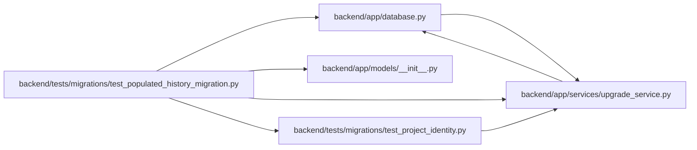

# test_populated_history_migration Module

**Path:** `backend/tests/migrations/test_populated_history_migration.py`

## Description

A deployment with a long retained history migrates to head and can be rolled back.

The project-identity scan once stopped after 10,000 history rows, so a seeded or
short-lived database passed while every deployment that had been used for a while
refused its next migration. These cases build such a history on the revision the
long-running deployments still run, migrate it, and roll it back.

## Imports

| Source | Symbols |
|--------|---------|
| `alembic` | `command` |
| `app` | `models` |
| `app.database` | `Base` |
| `app.services.upgrade_service` | `UpgradeError`, `alembic_config`, `head_revision`, `inspect_database`, `run_alembic_upgrade` |
| `datetime` | `UTC`, `date`, `datetime`, `timedelta` |
| `json` | `json` |
| `pytest` | `pytest` |
| `sqlalchemy` | `MetaData`, `Table`, `create_engine`, `func`, `select` |
| `sqlite3` | `sqlite3` |
| `tests.migrations.test_project_identity` | `insert_legacy_project` |
| `uuid` | `uuid4` |

## Local dependency map

<!-- Auto-generated local dependency summary. Do not edit by hand. -->

### Internal neighbors

| Direction | Module |
|---|---|
| Outbound | [app_database](../modules/app_database.md) |
| Outbound | [models___init__](../modules/models___init__.md) |
| Outbound | [upgrade_service](../modules/upgrade_service.md) |
| Outbound | [test_project_identity](../modules/test_project_identity.md) |

### External packages

| Language | Used packages | Undeclared packages |
|---|---:|---:|
| python | 3 | 1 |

## Functions

| Function | Signature | Decorators | Description |
|----------|-----------|------------|-------------|
| `_database` | `(dialect, request, tmp_path, configure_database)` | — | — |
| `_insert` | `(db, name, rows)` | — | Insert through the table as the prior revision defines it, filling mapped defaults. |
| `_moment` | `(number)` | — | — |
| `_retain_populated_history` | `(db)` | — | Bulk-insert a history shaped like a long-used deployment's: audit, events and time records. |
| `_history` | `(engine)` | — | Every retained history row, keyed by table, in a form that compares across revisions. |
| `_revision` | `(engine)` | — | — |
| `_populated_prior_database` | `(url)` | — | — |
| `_upgrade` | `(dialect, tmp_path)` | — | — |
| `test_populated_history_migrates_to_head_and_rolls_back` | `(dialect, request, tmp_path, configure_database)` | `@pytest.mark.parametrize('dialect', DIALECTS)` | — |
| `_audit` | `(db, details, action = 'projects:edit')` | — | — |
| `_predating_audit` | `(db)` | — | — |
| `_encoded_predating_audit` | `(db)` | — | — |
| `_bare_string_audit` | `(db)` | — | — |
| `_unreadable_event` | `(db)` | — | — |
| `test_inconsistent_row_after_a_long_history_still_refuses_the_migration` | `(dialect, inconsistency, request, tmp_path, configure_database)` | `@pytest.mark.parametrize('dialect', DIALECTS)`, `@pytest.mark.parametrize('inconsistency', [_predating_audit, _encoded_predating_audit, _bare_string_audit, _unreadable_event], ids=['predates-identity', 'encoded-predates-identity', 'bare-string', 'invalid'])` | — |
