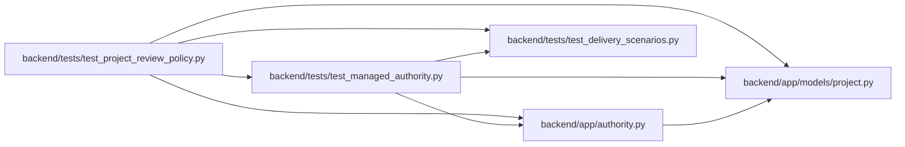

# test_project_review_policy Module

**Path:** `backend/tests/test_project_review_policy.py`

## Description

Project editors can round-trip the current policy. Changes need an operator.

## Imports

| Source | Symbols |
|--------|---------|
| `app.authority` | `Authority`, `AuthorityError` |
| `app.models.project` | `Project` |
| `pytest` | `pytest` |
| `sqlalchemy` | `insert`, `update` |
| `tests.test_delivery_scenarios` | `delivery_store` |
| `tests.test_managed_authority` | `client`, `managed_store` |

## Local dependency map

<!-- Auto-generated local dependency summary. Do not edit by hand. -->

### Internal neighbors

| Direction | Module |
|---|---|
| Outbound | [authority](../modules/authority.md) |
| Outbound | [models_project](../modules/models_project.md) |
| Outbound | [test_delivery_scenarios](../modules/test_delivery_scenarios.md) |
| Outbound | [test_managed_authority](../modules/test_managed_authority.md) |

### External packages

| Language | Used packages | Undeclared packages |
|---|---:|---:|
| python | 2 | 1 |

## Functions

| Function | Signature | Decorators | Description |
|----------|-----------|------------|-------------|
| `test_editor_round_trips_publisher_policy_and_operator_changes_it` | *(async)* `(managed_store)` | — | — |
| `test_project_policy_needs_operator_at_the_managed_write_boundary` | *(async)* `(managed_store)` | — | — |
