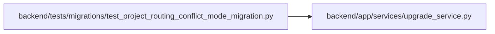

# test_project_routing_conflict_mode_migration Module

**Path:** `backend/tests/migrations/test_project_routing_conflict_mode_migration.py`

## Description

Existing projects start refusing inconsistent routing, and the setting round-trips a downgrade.

## Imports

| Source | Symbols |
|--------|---------|
| `alembic` | `command` |
| `alembic.script` | `ScriptDirectory` |
| `app.services.upgrade_service` | `alembic_config` |
| `pytest` | `pytest` |
| `sqlalchemy` | `create_engine`, `inspect`, `text` |
| `sqlalchemy.exc` | `IntegrityError` |

## Local dependency map

<!-- Auto-generated local dependency summary. Do not edit by hand. -->

### Internal neighbors

| Direction | Module |
|---|---|
| Outbound | [upgrade_service](../modules/upgrade_service.md) |

### External packages

| Language | Used packages | Undeclared packages |
|---|---:|---:|
| python | 3 | 1 |

## Functions

| Function | Signature | Decorators | Description |
|----------|-----------|------------|-------------|
| `test_upgrade_defaults_existing_projects_to_refuse_and_downgrade_removes_the_setting` | `(dialect, request, tmp_path, configure_database)` | `@pytest.mark.parametrize('dialect', [pytest.param('sqlite', marks=pytest.mark.sqlite), pytest.param('postgresql', marks=[pytest.mark.postgresql, pytest.mark.integration, pytest.mark.allow_network])])` | — |
