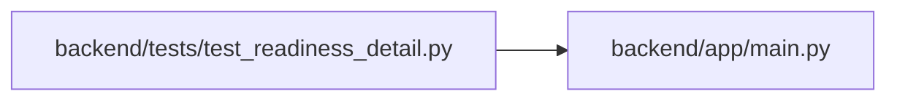

# test_readiness_detail Module

**Path:** `backend/tests/test_readiness_detail.py`

## Description

Managed readiness stays status-only unless the readiness-detail token matches.

## Imports

| Source | Symbols |
|--------|---------|
| `__future__` | `annotations` |
| `app` | `main` |
| `json` | `json` |
| `pytest` | `pytest` |
| `starlette.requests` | `Request` |
| `types` | `SimpleNamespace` |

## Local dependency map

<!-- Auto-generated local dependency summary. Do not edit by hand. -->

### Internal neighbors

| Direction | Module |
|---|---|
| Outbound | [app_main](../modules/app_main.md) |

### External packages

| Language | Used packages | Undeclared packages |
|---|---:|---:|
| python | 2 | 2 |

## Functions

| Function | Signature | Decorators | Description |
|----------|-----------|------------|-------------|
| `_request` | `(headers: dict[str, str]) -> Request` | — | — |
| `_readiness` | *(async)* `(monkeypatch: pytest.MonkeyPatch, *, auth_mode: str, token: str, headers: dict[str, str]) -> dict` | — | — |
| `test_managed_readiness_reveals_details_to_the_matching_token` | *(async)* `(monkeypatch: pytest.MonkeyPatch) -> None` | — | — |
| `test_managed_readiness_stays_status_only_without_a_matching_token` | *(async)* `(monkeypatch: pytest.MonkeyPatch, token: str, headers: dict[str, str]) -> None` | `@pytest.mark.parametrize(('token', 'headers'), [('detail-secret', {}), ('detail-secret', {'X-Readiness-Detail-Token': 'wrong'}), ('detail-secret', {'X-Readiness-Detail-Token': ''}), ('', {'X-Readiness-Detail-Token': ''}), ('', {'X-Readiness-Detail-Token': 'anything'})], ids=['absent', 'wrong', 'empty-header', 'unset-empty-header', 'unset'])` | — |
| `test_trusted_local_readiness_keeps_its_details` | *(async)* `(monkeypatch: pytest.MonkeyPatch) -> None` | — | — |
