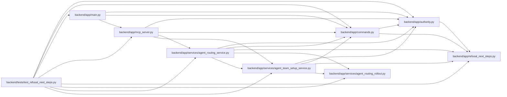

# test_refusal_next_steps Module

**Path:** `backend/tests/test_refusal_next_steps.py`

## Description

Every verification and review refusal names the legal next step, over REST, MCP and the task page.

## Imports

| Source | Symbols |
|--------|---------|
| `app` | `refusal_next_steps` |
| `app.authority` | `AuthorityError` |
| `app.commands` | `PlanningConflict` |
| `app.main` | `app` |
| `app.mcp_server` | `_structured_tool_error`, `mcp` |
| `app.refusal_next_steps` | `NEXT_STEPS`, `NOT_REFUSAL_CODES`, `next_step_for` |
| `app.services.agent_routing_rollout` | `AgentRoutingRolloutService` |
| `app.services.agent_routing_service` | `AgentRoutingConflictError`, `AgentRoutingService` |
| `app.services.agent_team_setup_service` | `AgentTeamSetupConflictError` |
| `json` | `json` |
| `pathlib` | `Path` |
| `pytest` | `pytest` |
| `re` | `re` |
| `types` | `SimpleNamespace` |

## Local dependency map

<!-- Auto-generated local dependency summary. Do not edit by hand. -->

### Internal neighbors

| Direction | Module |
|---|---|
| Outbound | [authority](../modules/authority.md) |
| Outbound | [commands](../modules/commands.md) |
| Outbound | [app_main](../modules/app_main.md) |
| Outbound | [mcp_server](../modules/mcp_server.md) |
| Outbound | [refusal_next_steps](../modules/refusal_next_steps.md) |
| Outbound | [agent_routing_rollout](../modules/agent_routing_rollout.md) |
| Outbound | [agent_routing_service](../modules/agent_routing_service.md) |
| Outbound | [agent_team_setup_service](../modules/agent_team_setup_service.md) |

### External packages

| Language | Used packages | Undeclared packages |
|---|---:|---:|
| python | 1 | 1 |

## Functions

| Function | Signature | Decorators | Description |
|----------|-----------|------------|-------------|
| `source_refusal_codes` | `()` | — | — |
| `test_every_verification_refusal_code_in_the_source_has_a_next_step` | `()` | — | — |
| `test_the_catalogue_names_no_code_the_source_no_longer_raises` | `()` | — | — |
| `route_templates` | `()` | — | — |
| `mcp_tool_names` | *(async)* `()` | — | — |
| `test_every_next_step_is_a_sentence_with_commands_that_exist` | *(async)* `()` | — | — |
| `test_a_kind_names_exactly_one_sentence_so_the_page_can_translate_it_by_kind` | `()` | — | — |
| `test_the_provenance_record_is_offered_only_where_the_refusal_names_that_remedy` | `()` | — | — |
| `test_a_disabled_deployment_switch_is_the_deployment_operators_step_not_team_readiness` | *(async)* `()` | — | — |
| `test_the_task_id_fills_the_command_templates_without_changing_the_catalogue` | `()` | — | — |
| `test_each_envelope_carries_the_same_next_step_over_rest_and_mcp` | `(code)` | `@pytest.mark.parametrize('code', sorted(NEXT_STEPS))` | — |
| `test_a_code_without_an_entry_and_an_explicit_next_step_are_left_alone` | `()` | — | — |
| `test_the_rollout_refusal_keeps_its_readiness_detail_and_gains_the_next_step` | `()` | — | — |
