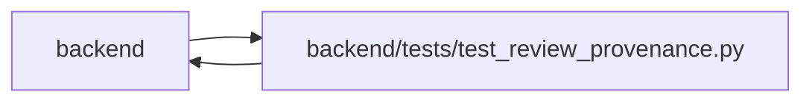

# test_review_provenance Module

**Path:** `backend/tests/test_review_provenance.py`

## Description

Exercise independent publisher review through the atomic work commands.

## Imports

| Source | Symbols |
|--------|---------|
| `app.authority` | `Authority`, `AuthorityError` |
| `app.models.agent` | `AgentIdempotencyRecord`, `AgentModelBinding`, `AgentModelCatalogEntry`, `AgentRun`, `AgentTaskAssignment` |
| `app.models.project` | `Project` |
| `app.schemas.agent` | `AgentReviewVerdict`, `AgentTaskAssignmentCreate`, `AgentWorkBegin`, `AgentWorkSubmit` |
| `app.schemas.agent_planning` | `AgentPlanningCommandContext` |
| `app.services.agent_routing_service` | `AgentRoutingConflictError` |
| `app.services.agent_work_service` | `AgentWorkService` |
| `app.services.execution_reconciliation` | `reconcile_execution` |
| `app.services.github_status_service` | `GitHubStatusService` |
| `app.services.identity_service` | `initialize_control_plane` |
| `app.services.review_provenance` | `actor_provenance`, `record_terminal_observation`, `review_history` |
| `app.services.task_brief_service` | `TaskBriefService` |
| `app.services.task_service` | `TaskService` |
| `app.utils.github_links` | `parse_github_url` |
| `app.utils.time` | `utc_now` |
| `datetime` | `timedelta` |
| `httpx` | `httpx` |
| `json` | `json` |
| `pytest` | `pytest` |
| `tests.support.transactions` | `reload_session_fixture` |
| `tests.test_agent_routing_service` | `_rollout`, `_routing_fixture` |
| `tests.test_team_pm_dispatch` | `db_session_factory` |
| `types` | `SimpleNamespace`, `SimpleNamespace` |

## Local dependency map

<!-- Auto-generated local dependency summary. Do not edit by hand. -->

> Module-level dependencies exceed the generated-diagram limits, so the diagram and table below group them by top-level package. Counts report the number of module neighbors in each package.

### Internal neighbors

| Direction | Module |
|---|---|
| Inbound | `backend` (9) |
| Outbound | `backend` (18) |

### External packages

| Language | Used packages | Undeclared packages |
|---|---:|---:|
| python | 2 | 1 |

> All 27 module neighbor(s) are summarized by package because the module-level view exceeds the 12-node limit.

## Functions

| Function | Signature | Decorators | Description |
|----------|-----------|------------|-------------|
| `command` | `(key)` | — | — |
| `test_omitted_review_fields_preserve_preexisting_idempotency_hashes` | `()` | `@pytest.mark.sqlite` | — |
| `test_supervised_execution_and_exact_independent_review` | *(async)* `(db_session, actor_factory, profile_factory, team_member_factory, task_factory)` | `@pytest.mark.asyncio`, `@database_engines` | — |
| `test_legacy_history_never_uses_the_actors_current_configuration` | *(async)* `(db_session, actor_factory, profile_factory, team_member_factory, task_factory)` | `@pytest.mark.asyncio`, `@database_engines` | — |
| `test_binding_receipt_without_independent_catalog_history_cannot_name_a_publisher` | *(async)* `(db_session, actor_factory, profile_factory, team_member_factory, task_factory)` | `@pytest.mark.asyncio`, `@database_engines` | — |
| `test_github_candidate_uses_full_head_and_contributions` | *(async)* `()` | `@pytest.mark.asyncio`, `@pytest.mark.sqlite` | — |
| `test_commit_only_review_verifies_the_entire_pinned_range` | *(async)* `()` | `@pytest.mark.asyncio`, `@pytest.mark.sqlite` | — |
| `test_interrupted_work_retains_both_observed_publishers` | *(async)* `(db_session, actor_factory, profile_factory, team_member_factory, task_factory)` | `@pytest.mark.asyncio`, `@database_engines` | — |
| `test_same_reported_alias_cannot_hide_a_revised_publisher` | *(async)* `(db_session, actor_factory, profile_factory, team_member_factory, task_factory)` | `@pytest.mark.asyncio`, `@database_engines` | — |
| `test_unassigned_run_remains_unknown_and_optional_supervisor_needs_no_profile` | *(async)* `(db_session, actor_factory, profile_factory, team_member_factory, task_factory)` | `@pytest.mark.asyncio`, `@database_engines` | — |
