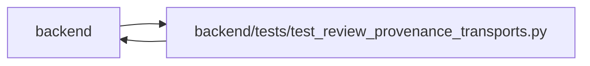

# test_review_provenance_transports Module

**Path:** `backend/tests/test_review_provenance_transports.py`

## Description

Exercise strict review, interruption and return through the registered worker and PM protocols.

## Imports

| Source | Symbols |
|--------|---------|
| `app.config` | `get_settings` |
| `app.models.agent` | `AgentModelCatalogEntry`, `AgentRun`, `AgentTaskAssignment`, `TaskEvent` |
| `app.models.iteration` | `Iteration` |
| `app.models.project` | `Project` |
| `app.models.task` | `Task` |
| `app.services.github_status_service` | `GitHubStatusService` |
| `app.services.review_provenance` | `recover_terminal_observation` |
| `app.utils.time` | `utc_now` |
| `datetime` | `timedelta` |
| `httpx` | `httpx` |
| `pytest` | `pytest` |
| `sqlalchemy` | `select` |
| `tests.test_agent_team_setup_qualification` | `provision_ready_topology`, `routing_base` |
| `tests.test_team_pm_dispatch` | `db_session_factory` |
| `tests.test_team_pm_recovery` | `recovery_api` |

## Local dependency map

<!-- Auto-generated local dependency summary. Do not edit by hand. -->

> Module-level dependencies exceed the generated-diagram limits, so the diagram and table below group them by top-level package. Counts report the number of module neighbors in each package.

### Internal neighbors

| Direction | Module |
|---|---|
| Inbound | `backend` (9) |
| Outbound | `backend` (11) |

### External packages

| Language | Used packages | Undeclared packages |
|---|---:|---:|
| python | 3 | 1 |

> All 20 module neighbor(s) are summarized by package because the module-level view exceeds the 12-node limit.

## Functions

| Function | Signature | Decorators | Description |
|----------|-----------|------------|-------------|
| `fence` | `(receipt)` | — | — |
| `test_strict_recovery_and_provider_review` | *(async)* `(db_session, db_session_factory, task_factory, team_member_factory, monkeypatch, transport, outcome)` | `@databases`, `@pytest.mark.parametrize('transport', ['rest', 'mcp'])`, `@pytest.mark.parametrize('outcome', ['sealed_pass', 'sealed_rework', 'unknown'])`, `@pytest.mark.usefixtures('deployed_agent_skill_release')` | — |
