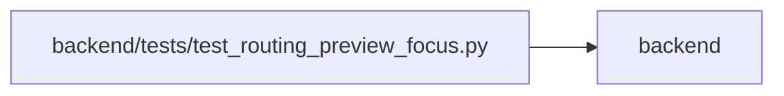

# test_routing_preview_focus Module

**Path:** `backend/tests/test_routing_preview_focus.py`

## Description

A focused routing preview keeps a named team actor's rows inside the bounded response.

## Imports

| Source | Symbols |
|--------|---------|
| `app.config` | `get_settings` |
| `app.models.agent` | `AgentActor`, `AgentModelBinding`, `AgentModelCatalogEntry`, `AgentRun`, `AgentTaskAssignment` |
| `app.models.iteration` | `Iteration` |
| `app.schemas.agent` | `ModelAwareAgentTaskAssignmentCreate` |
| `app.schemas.agent_routing` | `AgentRoutingPreviewCreate` |
| `app.services` | `agent_routing_service` |
| `app.services.agent_routing_policy` | `MAX_ROUTING_EXCLUSIONS`, `MAX_ROUTING_PACKET_BYTES`, `canonical_routing_json_bytes` |
| `app.services.agent_routing_service` | `AgentRoutingConflictError`, `AgentRoutingService`, `_bounded_rows`, `_routing_row_focus` |
| `app.services.agent_work_service` | `AgentWorkService` |
| `app.services.task_service` | `TaskService` |
| `app.utils.time` | `utc_now` |
| `json` | `json` |
| `pydantic` | `ValidationError` |
| `pytest` | `pytest` |
| `sqlalchemy` | `select` |
| `tests.support.transactions` | `reload_session_fixture` |
| `tests.test_agent_routing_service` | `_command_context` |
| `tests.test_agent_routing_wave6_qualification` | `_assessment_command`, `_dispatch` |
| `tests.test_agent_team_setup_qualification` | `acknowledge_all`, `default_candidate`, `provision_ready_topology`, `routing_base` |
| `tests.test_review_provenance` | `database_engines` |
| `tests.test_scoped_review_evidence` | `through` |
| `tests.test_team_pm_dispatch` | `db_session_factory` |
| `types` | `SimpleNamespace` |

## Local dependency map

<!-- Auto-generated local dependency summary. Do not edit by hand. -->

> Module-level dependencies exceed the generated-diagram limits, so the diagram and table below group them by top-level package. Counts report the number of module neighbors in each package.

### Internal neighbors

| Direction | Module |
|---|---|
| Outbound | `backend` (17) |

### External packages

| Language | Used packages | Undeclared packages |
|---|---:|---:|
| python | 3 | 1 |

> All 17 module neighbor(s) are summarized by package because the module-level view exceeds the 12-node limit.

## Functions

| Function | Signature | Decorators | Description |
|----------|-----------|------------|-------------|
| `restore_settings_cache` | `()` | `@pytest.fixture(autouse=True)` | — |
| `size` | `(value)` | — | — |
| `find` | `(items, actor_id, binding_id)` | — | — |
| `totals` | `(preview)` | — | — |
| `catalog_entry` | `(key, *, alias = None)` | — | — |
| `bind_fillers` | *(async)* `(db, actor, prefix, count, *, enabled, alias = None, tool_tags = ())` | — | — |
| `occupy` | *(async)* `(db, actor, iteration, task_factory, title)` | — | Give the actor accepted work elsewhere with a running run. |
| `preview_reader` | `(db_session_factory, monkeypatch, task_id, base_body)` | — | — |
| `test_focused_binding_requires_its_actor` | `()` | `@pytest.mark.sqlite` | — |
| `test_focus_returns_named_worker_blockers_and_selection_on_rest_and_mcp` | *(async)* `(db_session, db_session_factory, actor_factory, team_member_factory, task_factory, monkeypatch)` | `@database_engines`, `@pytest.mark.usefixtures('deployed_agent_skill_release', 'qualified_model_aware_routing_test_context')` | — |
| `test_focus_returns_named_reviewer_blockers_on_rest_and_mcp` | *(async)* `(db_session, db_session_factory, team_member_factory, task_factory, monkeypatch)` | `@database_engines`, `@pytest.mark.usefixtures('deployed_agent_skill_release', 'qualified_model_aware_routing_test_context')` | — |
| `test_bounded_rows_keep_first_row_ahead_of_focused_rows` | `()` | `@pytest.mark.sqlite` | — |
| `test_focused_digest_selects_only_its_named_binding` | *(async)* `(db_session, db_session_factory, actor_factory, team_member_factory, task_factory, monkeypatch, primary)` | `@database_engines`, `@pytest.mark.parametrize('primary', ['rest', 'mcp'])`, `@pytest.mark.usefixtures('deployed_agent_skill_release', 'qualified_model_aware_routing_test_context')` | — |
| `test_focused_rows_that_fill_the_bound_keep_the_recommendation` | *(async)* `(db_session, db_session_factory, team_member_factory, task_factory, monkeypatch)` | `@database_engines`, `@pytest.mark.usefixtures('deployed_agent_skill_release', 'qualified_model_aware_routing_test_context')` | — |
