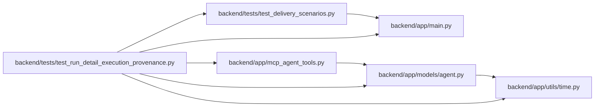

# test_run_detail_execution_provenance Module

**Path:** `backend/tests/test_run_detail_execution_provenance.py`

## Description

Run detail returns the stored execution provenance through REST and MCP alike.

## Imports

| Source | Symbols |
|--------|---------|
| `app` | `mcp_agent_tools` |
| `app.main` | `app` |
| `app.models.agent` | `AgentActor`, `AgentRun` |
| `app.utils.time` | `utc_now` |
| `datetime` | `timedelta` |
| `httpx` | `httpx` |
| `pytest` | `pytest` |
| `tests.test_delivery_scenarios` | `delivery_store` |

## Local dependency map

<!-- Auto-generated local dependency summary. Do not edit by hand. -->

### Internal neighbors

| Direction | Module |
|---|---|
| Outbound | [app_main](../modules/app_main.md) |
| Outbound | [mcp_agent_tools](../modules/mcp_agent_tools.md) |
| Outbound | [models_agent](../modules/models_agent.md) |
| Outbound | [time](../modules/time.md) |
| Outbound | [test_delivery_scenarios](../modules/test_delivery_scenarios.md) |

### External packages

| Language | Used packages | Undeclared packages |
|---|---:|---:|
| python | 2 | 1 |

## Functions

| Function | Signature | Decorators | Description |
|----------|-----------|------------|-------------|
| `fresh_provenance` | `(actor_id)` | — | — |
| `reconciled_provenance` | `(actor_id)` | — | — |
| `test_run_detail_rest_and_mcp_return_the_same_stored_provenance` | *(async)* `(delivery_store, build)` | `@pytest.mark.parametrize('build', [fresh_provenance, reconciled_provenance], ids=['fresh', 'reconciled'])` | — |
