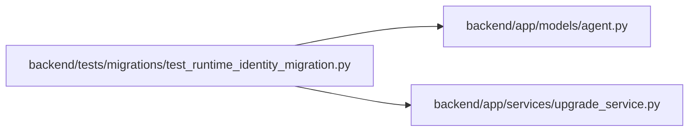

# test_runtime_identity_migration Module

**Path:** `backend/tests/migrations/test_runtime_identity_migration.py`

## Description

The runtime instance columns migrate reversibly and are never dropped silently.

## Imports

| Source | Symbols |
|--------|---------|
| `alembic` | `command` |
| `app.models.agent` | `AgentTeamTopology`, `AgentTeamTopologyMember` |
| `app.services.upgrade_service` | `alembic_config` |
| `datetime` | `datetime`, `timezone` |
| `pytest` | `pytest` |
| `re` | `re` |
| `sqlalchemy` | `sa`, `create_engine`, `inspect`, `select` |

## Local dependency map

<!-- Auto-generated local dependency summary. Do not edit by hand. -->

### Internal neighbors

| Direction | Module |
|---|---|
| Outbound | [models_agent](../modules/models_agent.md) |
| Outbound | [upgrade_service](../modules/upgrade_service.md) |

### External packages

| Language | Used packages | Undeclared packages |
|---|---:|---:|
| python | 3 | 1 |

## Functions

| Function | Signature | Decorators | Description |
|----------|-----------|------------|-------------|
| `filled` | `(table, **values)` | — | One row with a placeholder for every column that must be set, and the given values. |
| `written_before` | `(table, **values)` | — | A row as the earlier schema holds it: every required column, with its default, and none of the new ones. |
| `test_runtime_identity_migration_issues_random_identities_and_refuses_losing_an_identity` | `(dialect, request, tmp_path, configure_database)` | `@pytest.mark.parametrize('dialect', [pytest.param('sqlite', marks=pytest.mark.sqlite), pytest.param('postgresql', marks=[pytest.mark.postgresql, pytest.mark.integration, pytest.mark.allow_network])])` | — |
