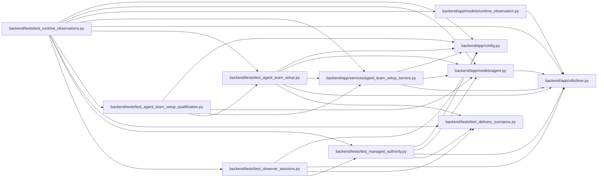

# test_runtime_observations Module

**Path:** `backend/tests/test_runtime_observations.py`

## Description

Advisory runtime observations: who may record and read them, and that dispatch never sees them.

## Imports

| Source | Symbols |
|--------|---------|
| `app.config` | `get_settings` |
| `app.models.agent` | `AgentActor`, `AgentRun`, `AgentTaskAssignment`, `AgentTeamTopologyMember`, `TaskEvent` |
| `app.models.runtime_observation` | `AgentRuntimeObservation` |
| `app.services.agent_team_setup_service` | `AgentTeamSetupService` |
| `app.utils.time` | `utc_now` |
| `datetime` | `timedelta` |
| `json` | `json` |
| `pathlib` | `Path` |
| `pytest` | `pytest` |
| `sqlalchemy` | `func`, `select` |
| `tests.test_agent_team_setup` | `operator` |
| `tests.test_agent_team_setup_qualification` | `provision_ready_topology` |
| `tests.test_delivery_scenarios` | `delivery_store` |
| `tests.test_managed_authority` | `client`, `managed_store` |
| `tests.test_observer_sessions` | `approve_with`, `bearer`, `exchange`, `local_store`, `pair_managed`, `start` |

## Local dependency map

<!-- Auto-generated local dependency summary. Do not edit by hand. -->

### Internal neighbors

| Direction | Module |
|---|---|
| Outbound | [config](../modules/config.md) |
| Outbound | [models_agent](../modules/models_agent.md) |
| Outbound | [models_runtime_observation](../modules/models_runtime_observation.md) |
| Outbound | [agent_team_setup_service](../modules/agent_team_setup_service.md) |
| Outbound | [time](../modules/time.md) |
| Outbound | [test_agent_team_setup](../modules/test_agent_team_setup.md) |
| Outbound | [test_agent_team_setup_qualification](../modules/test_agent_team_setup_qualification.md) |
| Outbound | [test_delivery_scenarios](../modules/test_delivery_scenarios.md) |
| Outbound | [test_managed_authority](../modules/test_managed_authority.md) |
| Outbound | [test_observer_sessions](../modules/test_observer_sessions.md) |

### External packages

| Language | Used packages | Undeclared packages |
|---|---:|---:|
| python | 2 | 1 |

## Functions

| Function | Signature | Decorators | Description |
|----------|-----------|------------|-------------|
| `observation` | `(key = 'obs-1', **overrides)` | — | — |
| `pair_local` | *(async)* `(label = 'Desk reader')` | — | — |
| `test_a_local_observer_records_advisory_observations_once` | *(async)* `(local_store)` | — | — |
| `test_malformed_observations_are_refused` | *(async)* `(local_store, harness)` | `@pytest.mark.parametrize('harness', [{'harness_session_id': '/home/me/.claude/7f3c.jsonl'}, {'harness_kind': 'Claude Code'}, {'observed_at': '2026-01-01T00:00:00+00:00'}])` | — |
| `test_managed_observations_follow_task_access_and_agents_cannot_use_them` | *(async)* `(managed_store)` | — | — |
| `test_an_observer_is_capped_per_hour` | *(async)* `(local_store, monkeypatch)` | — | — |
| `test_operators_remove_observations_past_retention` | *(async)* `(managed_store)` | — | — |
| `test_no_dispatch_code_reads_observations` | `()` | — | Routing, readiness, assignment and work decisions never import or query the observation table. |
| `test_recording_observations_changes_nothing_dispatch_reads` | *(async)* `(local_store, monkeypatch)` | `@pytest.mark.usefixtures('deployed_agent_skill_release')` | — |
