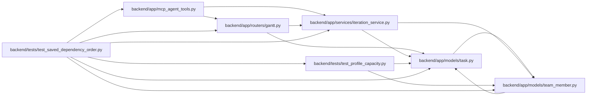

# test_saved_dependency_order Module

**Path:** `backend/tests/test_saved_dependency_order.py`

## Description

Saved dependency order: persisted dates that start a dependent before its prerequisite ends.

## Imports

| Source | Symbols |
|--------|---------|
| `app` | `mcp_agent_tools` |
| `app.models.task` | `Task`, `TaskDependency`, `TaskStatus` |
| `app.models.team_member` | `TeamMemberProfile` |
| `app.routers.gantt` | `get_gantt_data` |
| `app.services.iteration_service` | `IterationService` |
| `datetime` | `date`, `datetime`, `UTC` |
| `pytest` | `pytest` |
| `sqlalchemy` | `select` |
| `tests.test_profile_capacity` | `allocation`, `db_session` |

## Local dependency map

<!-- Auto-generated local dependency summary. Do not edit by hand. -->

### Internal neighbors

| Direction | Module |
|---|---|
| Outbound | [mcp_agent_tools](../modules/mcp_agent_tools.md) |
| Outbound | [models_task](../modules/models_task.md) |
| Outbound | [team_member](../modules/team_member.md) |
| Outbound | [routers_gantt](../modules/routers_gantt.md) |
| Outbound | [iteration_service](../modules/iteration_service.md) |
| Outbound | [test_profile_capacity](../modules/test_profile_capacity.md) |

### External packages

| Language | Used packages | Undeclared packages |
|---|---:|---:|
| python | 2 | 1 |

## Functions

| Function | Signature | Decorators | Description |
|----------|-----------|------------|-------------|
| `_task` | `(member, title, start, end, **extra)` | — | — |
| `_today_inside_the_iteration` | `(monkeypatch)` | `@pytest.fixture(autouse=True)` | — |
| `_saved_plan` | *(async)* `(db, *, noise = True)` | — | — |
| `_snapshot` | *(async)* `(db)` | — | — |
| `test_readiness_lists_inverted_pairs_and_the_schedule_checkpoint_waits` | *(async)* `(db_session)` | `@pytest.mark.asyncio` | — |
| `test_gantt_rest_and_mcp_flag_the_same_pairs_without_writing` | *(async)* `(db_session)` | `@pytest.mark.asyncio` | — |
| `test_correctly_ordered_saved_dates_leave_the_schedule_checkpoint_done` | *(async)* `(db_session)` | `@pytest.mark.asyncio` | — |
