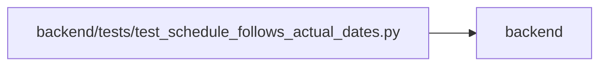

# test_schedule_follows_actual_dates Module

**Path:** `backend/tests/test_schedule_follows_actual_dates.py`

## Description

Agents start work whose dependencies are done, and the plan's dates follow what happened.

## Imports

| Source | Symbols |
|--------|---------|
| `app.main` | `app` |
| `app.models.agent` | `AgentActor`, `AgentTaskAssignment`, `TaskEvent` |
| `app.models.iteration` | `Iteration` |
| `app.models.task` | `Task` |
| `app.models.team_member` | `TeamMember`, `TeamMemberProfile` |
| `app.schemas.task` | `TaskCreate` |
| `app.schemas.task_brief` | `BriefCriterion`, `TaskBrief` |
| `app.services` | `agent_work_service`, `backlog_snapshot_service`, `work_metrics` |
| `app.services.scheduler_service` | `rebind_queued_assignments` |
| `app.services.task_service` | `TaskService` |
| `app.utils` | `time` |
| `datetime` | `date`, `datetime` |
| `httpx` | `httpx` |
| `json` | `json` |
| `pytest` | `pytest` |
| `sqlalchemy` | `select` |
| `tests.test_delivery_scenarios` | `delivery_store` |

## Local dependency map

<!-- Auto-generated local dependency summary. Do not edit by hand. -->

> Module-level dependencies exceed the generated-diagram limits, so the diagram and table below group them by top-level package. Counts report the number of module neighbors in each package.

### Internal neighbors

| Direction | Module |
|---|---|
| Outbound | `backend` (14) |

### External packages

| Language | Used packages | Undeclared packages |
|---|---:|---:|
| python | 3 | 1 |

> All 14 module neighbor(s) are summarized by package because the module-level view exceeds the 12-node limit.

## Functions

| Function | Signature | Decorators | Description |
|----------|-----------|------------|-------------|
| `fixed_clock` | `(monkeypatch)` | `@pytest.fixture` | — |
| `_brief` | `() -> TaskBrief` | — | — |
| `_seed` | *(async)* `(factory, scenario, plan, *, assigned = True)` | — | Create one agent capacity row and the planned tasks in ``plan``. |
| `_headers` | `(scenario, key)` | — | — |
| `_begin_next` | *(async)* `(client, scenario, key)` | — | — |
| `_submit` | *(async)* `(client, scenario, receipt, key)` | — | — |
| `_dates` | *(async)* `(factory, ids)` | — | — |
| `_client` | `()` | — | — |
| `test_early_start_and_early_finish_pull_the_row_and_dependents_forward` | *(async)* `(delivery_store, fixed_clock)` | — | — |
| `test_late_start_moves_dependents_later_and_keeps_their_dispatch` | *(async)* `(delivery_store, fixed_clock)` | — | — |
| `test_unfinished_dependency_still_holds_work_back` | *(async)* `(delivery_store, fixed_clock)` | — | — |
| `test_a_planning_period_that_has_not_begun_holds_work_back` | *(async)* `(delivery_store, fixed_clock)` | — | — |
| `test_following_actual_dates_never_removes_a_date` | *(async)* `(delivery_store, fixed_clock)` | — | A plan loaded without assignees keeps its dates when one of its tasks starts. |
| `test_only_plain_queued_assignments_follow_a_change_of_dates` | *(async)* `(delivery_store)` | — | — |
