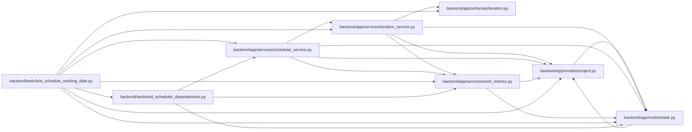

# test_schedule_working_date Module

**Path:** `backend/tests/test_schedule_working_date.py`

## Description

Forecasts respect the working date and readiness rejects stale saved dates.

## Imports

| Source | Symbols |
|--------|---------|
| `app.models.project` | `Project` |
| `app.models.task` | `Task` |
| `app.schemas.iteration` | `IterationUpdate` |
| `app.services` | `work_metrics` |
| `app.services.iteration_service` | `IterationService` |
| `app.services.scheduler_service` | `IncrementalScheduler`, `SchedulerService` |
| `datetime` | `UTC`, `date`, `datetime` |
| `pytest` | `pytest` |
| `tests.test_scheduler_dependencies` | `make_plan` |

## Local dependency map

<!-- Auto-generated local dependency summary. Do not edit by hand. -->

### Internal neighbors

| Direction | Module |
|---|---|
| Outbound | [models_project](../modules/models_project.md) |
| Outbound | [models_task](../modules/models_task.md) |
| Outbound | [schemas_iteration](../modules/schemas_iteration.md) |
| Outbound | [iteration_service](../modules/iteration_service.md) |
| Outbound | [scheduler_service](../modules/scheduler_service.md) |
| Outbound | [services_work_metrics](../modules/services_work_metrics.md) |
| Outbound | [test_scheduler_dependencies](../modules/test_scheduler_dependencies.md) |

### External packages

| Language | Used packages | Undeclared packages |
|---|---:|---:|
| python | 1 | 1 |

## Functions

| Function | Signature | Decorators | Description |
|----------|-----------|------------|-------------|
| `fixed_working_date` | `(monkeypatch)` | `@pytest.fixture(autouse=True)` | — |
| `current_plan` | *(async)* `(db)` | — | — |
| `test_unstarted_work_starts_no_earlier_than_workspace_today` | *(async)* `(db_session, incremental, project_zone, calendar_zone, expected)` | `@pytest.mark.parametrize('incremental', [False, True], ids=['full', 'incremental'])`, `@pytest.mark.parametrize('project_zone, calendar_zone, expected', [(None, 'UTC', date(2026, 11, 17)), (None, 'Asia/Tokyo', date(2026, 11, 18)), ('America/Los_Angeles', 'Asia/Tokyo', date(2026, 11, 17)), ('Asia/Tokyo', 'America/Los_Angeles', date(2026, 11, 18))])` | — |
| `test_schedule_keeps_started_and_done_dates` | *(async)* `(db_session, status)` | `@pytest.mark.parametrize('status', ['active', 'resolved', 'closed'])` | — |
| `test_recalculation_preserves_started_dates_outside_moved_iteration` | *(async)* `(db_session, status, changed_dates)` | `@pytest.mark.parametrize('status', ['active', 'resolved', 'closed'])`, `@pytest.mark.parametrize('changed_dates', [{'start_date': date(2026, 11, 18)}, {'end_date': date(2026, 11, 19)}], ids=['start_moved_forward', 'end_moved_back'])` | — |
| `test_future_iteration_and_nonworking_dates_still_bound_forecasts` | *(async)* `(db_session)` | — | — |
| `test_moving_iteration_dates_requires_schedule_recalculation` | *(async)* `(db_session, changed_dates)` | `@pytest.mark.parametrize('changed_dates', [{'start_date': date(2026, 11, 18)}, {'end_date': date(2026, 11, 16)}], ids=['start_moved_forward', 'end_moved_back'])` | — |
| `test_saved_unstarted_work_before_today_requires_recalculation` | *(async)* `(db_session)` | — | — |
| `test_readiness_and_scheduler_use_same_workspace_date` | *(async)* `(db_session)` | — | — |
| `test_excluded_and_structural_dates_do_not_invalidate_schedule` | *(async)* `(db_session)` | — | — |
| `test_readiness_flags_iteration_outside_calendar_year` | *(async)* `(db_session, start, end)` | `@pytest.mark.parametrize('start,end', [(date(2027, 1, 1), date(2027, 1, 31)), (date(2026, 12, 28), date(2027, 1, 4))])` | — |
| `test_schedule_omits_undated_deferred_tasks` | *(async)* `(db_session, commit)` | `@pytest.mark.parametrize('commit', [False, True], ids=['preview', 'apply'])` | — |
