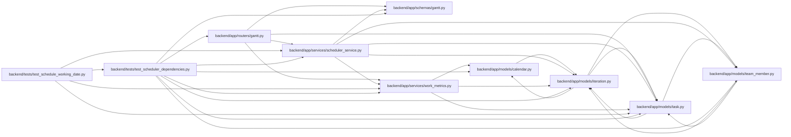

# test_scheduler_dependencies Module

**Path:** `backend/tests/test_scheduler_dependencies.py`

## Description

Dependency-ready scheduling across capacity rows and configured passes.

## Imports

| Source | Symbols |
|--------|---------|
| `app.models.calendar` | `Calendar` |
| `app.models.iteration` | `Iteration` |
| `app.models.task` | `Task`, `TaskDependency` |
| `app.models.team_member` | `TeamMember`, `TeamMemberProfile`, `Vacation` |
| `app.routers.gantt` | `preview_iteration_schedule`, `schedule_iteration` |
| `app.schemas.gantt` | `ScheduleApplyRequest`, `SchedulePreviewRequest` |
| `app.services` | `work_metrics` |
| `app.services.scheduler_service` | `SchedulerService` |
| `datetime` | `date`, `datetime`, `timezone` |
| `pytest` | `pytest` |
| `random` | `random` |
| `time` | `perf_counter` |
| `types` | `SimpleNamespace` |

## Local dependency map

<!-- Auto-generated local dependency summary. Do not edit by hand. -->

### Internal neighbors

| Direction | Module |
|---|---|
| Inbound | [test_schedule_working_date](../modules/test_schedule_working_date.md) |
| Outbound | [models_calendar](../modules/models_calendar.md) |
| Outbound | [models_iteration](../modules/models_iteration.md) |
| Outbound | [models_task](../modules/models_task.md) |
| Outbound | [team_member](../modules/team_member.md) |
| Outbound | [routers_gantt](../modules/routers_gantt.md) |
| Outbound | [schemas_gantt](../modules/schemas_gantt.md) |
| Outbound | [scheduler_service](../modules/scheduler_service.md) |
| Outbound | [services_work_metrics](../modules/services_work_metrics.md) |

### External packages

| Language | Used packages | Undeclared packages |
|---|---:|---:|
| python | 1 | 1 |

## Functions

| Function | Signature | Decorators | Description |
|----------|-----------|------------|-------------|
| `fixed_working_date` | `(monkeypatch)` | `@pytest.fixture(autouse=True)` | — |
| `make_plan` | *(async)* `(db, rows, assignments, edges, *, end = date(2026, 12, 31))` | — | — |
| `assert_dependency_dates` | `(tasks, edges)` | — | — |
| `assert_serial_rows` | `(tasks)` | — | — |
| `test_two_rows_with_dependencies_in_both_directions` | *(async)* `(db_session, monkeypatch, fallback)` | `@pytest.mark.parametrize('fallback', [False, True])` | — |
| `test_dependency_chain_crosses_three_rows` | *(async)* `(db_session)` | — | — |
| `generated_plan` | `()` | — | — |
| `test_generated_plan_has_no_dependency_or_capacity_overlap` | *(async)* `(db_session)` | — | — |
| `test_undated_predecessor_leaves_dependents_undated_and_named` | *(async)* `(db_session, cause)` | `@pytest.mark.parametrize('cause', ['unassigned', 'no_estimate', 'blocked', 'deferred', 'active'])` | — |
| `test_finished_predecessor_does_not_delay_dependents` | *(async)* `(db_session, status, saved_dates, follow_date)` | `@pytest.mark.parametrize('status', ['resolved', 'closed', 'canceled'])`, `@pytest.mark.parametrize('saved_dates', [(None, None), (date(2026, 2, 2), None), (None, date(2026, 2, 3)), (date(2026, 2, 2), date(2026, 2, 3))], ids=['undated', 'start_only', 'end_only', 'dated'])`, `@pytest.mark.parametrize('follow_date', [None, date(2026, 1, 12)], ids=['schedule', 'follow'])` | — |
| `test_ready_tasks_keep_pass_priority_and_cross_pass_dependencies` | *(async)* `(db_session)` | — | — |
| `test_row_stays_serial_after_iteration_overflow` | *(async)* `(db_session)` | — | — |
| `test_dependencies_preserve_calendars_time_off_modifiers_and_locked_dates` | *(async)* `(db_session)` | — | — |
| `test_reassigned_tasks_preview_and_apply_without_capacity_refusal` | *(async)* `(db_session)` | — | — |
| `test_summary_predecessor_waits_for_current_child_dates` | *(async)* `(db_session, missing_child)` | `@pytest.mark.parametrize('missing_child', [False, True])` | — |
| `test_finished_child_does_not_block_summary_dependents` | *(async)* `(db_session, status, saved_dates, planned_sibling)` | `@pytest.mark.parametrize('status', ['resolved', 'closed', 'canceled'])`, `@pytest.mark.parametrize('saved_dates', [(None, None), (date(2026, 2, 2), None), (None, date(2026, 2, 3)), (date(2026, 2, 2), date(2026, 2, 3))], ids=['undated', 'start_only', 'end_only', 'dated'])`, `@pytest.mark.parametrize('planned_sibling', [False, True], ids=['finished_only', 'mixed'])` | — |
| `test_finished_undated_child_satisfies_nested_summaries` | *(async)* `(db_session, status)` | `@pytest.mark.parametrize('status', ['resolved', 'closed', 'canceled'])` | — |
| `test_task_dependency_cycle_is_left_unscheduled` | *(async)* `(db_session)` | — | — |
| `test_planned_work_does_not_straddle_locked_work_on_short_days` | *(async)* `(db_session)` | — | — |
