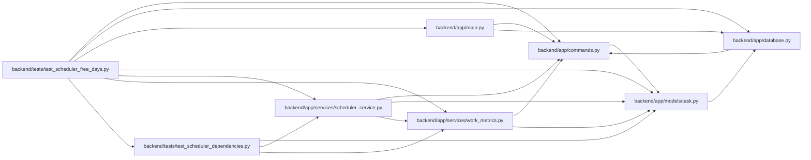

# test_scheduler_free_days Module

**Path:** `backend/tests/test_scheduler_free_days.py`

## Description

Ready lower-ranked work uses an assignee's free days before higher-ranked work that waits.

## Imports

| Source | Symbols |
|--------|---------|
| `app.commands` | `command_transaction` |
| `app.database` | `get_db` |
| `app.main` | `app` |
| `app.models.task` | `Task` |
| `app.services` | `work_metrics` |
| `app.services.scheduler_service` | `SchedulerService` |
| `datetime` | `date`, `datetime`, `timezone` |
| `fastapi` | `Request` |
| `httpx` | `httpx` |
| `pytest` | `pytest` |
| `random` | `random` |
| `tests.test_scheduler_dependencies` | `assert_dependency_dates`, `assert_serial_rows`, `make_plan` |

## Local dependency map

<!-- Auto-generated local dependency summary. Do not edit by hand. -->

### Internal neighbors

| Direction | Module |
|---|---|
| Outbound | [commands](../modules/commands.md) |
| Outbound | [app_database](../modules/app_database.md) |
| Outbound | [app_main](../modules/app_main.md) |
| Outbound | [models_task](../modules/models_task.md) |
| Outbound | [scheduler_service](../modules/scheduler_service.md) |
| Outbound | [services_work_metrics](../modules/services_work_metrics.md) |
| Outbound | [test_scheduler_dependencies](../modules/test_scheduler_dependencies.md) |

### External packages

| Language | Used packages | Undeclared packages |
|---|---:|---:|
| python | 3 | 1 |

## Functions

| Function | Signature | Decorators | Description |
|----------|-----------|------------|-------------|
| `fixed_working_date` | `(monkeypatch)` | `@pytest.fixture(autouse=True)` | — |
| `waiting_plan` | *(async)* `(db, *, low_hours = 24)` | — | Row 0: a high-priority task waiting on row 1's five-day prerequisite, and ready low-priority work. |
| `dates` | `(tasks)` | — | — |
| `test_ready_lower_priority_work_uses_free_days_before_waiting_work` | *(async)* `(db_session)` | — | — |
| `test_work_that_does_not_fit_the_free_days_follows_the_waiting_work` | *(async)* `(db_session)` | — | — |
| `test_an_earliest_start_date_is_named_as_the_cause_of_idle_days` | *(async)* `(db_session)` | — | — |
| `test_dates_kept_as_saved_do_not_occupy_the_row` | *(async)* `(db_session)` | — | Kept dates are not part of the plan the run placed: other work may use those days. |
| `test_kept_dates_split_idle_days_that_the_next_task_still_explains` | *(async)* `(db_session)` | — | — |
| `test_idle_days_name_the_constraint_that_binds` | *(async)* `(db_session, prerequisite_hours, min_start, reason, starts)` | `@pytest.mark.parametrize(('prerequisite_hours', 'min_start', 'reason', 'starts'), [(16, date(2026, 1, 8), 'earliest_start', date(2026, 1, 8)), (40, date(2026, 1, 7), 'waits_for_prerequisite', date(2026, 1, 12))])` | — |
| `test_an_earliest_start_on_a_weekend_is_named_from_the_next_working_day` | *(async)* `(db_session)` | — | — |
| `test_free_days_after_the_iteration_end_are_reported_overdue` | *(async)* `(db_session)` | — | — |
| `test_schedule_preview_lists_idle_days` | *(async)* `(db_session_factory)` | — | — |
| `random_plan` | `(seed)` | — | — |
| `schedule_random_plan` | *(async)* `(db, seed)` | — | — |
| `test_no_task_starts_later_than_under_the_row_cursor_alone` | *(async)* `(db_session, monkeypatch, seed)` | `@pytest.mark.parametrize('seed', [3, 17, 29, 41, 58, 73])` | — |
| `test_the_same_inputs_give_the_same_dates_on_every_run` | *(async)* `(db_session)` | — | — |
