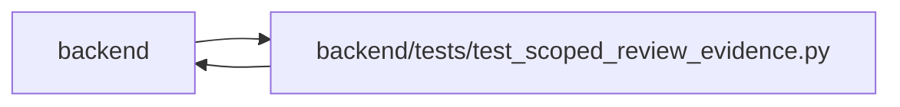

# test_scoped_review_evidence Module

**Path:** `backend/tests/test_scoped_review_evidence.py`

## Description

Only the named independent reviewer can consume current, operator-attested review material.

## Imports

| Source | Symbols |
|--------|---------|
| `app` | `database`, `mcp_server` |
| `app.authority` | `Authority`, `AuthorityError` |
| `app.config` | `get_settings` |
| `app.main` | `app` |
| `app.models.agent` | `AgentModelBinding`, `AgentModelCatalogEntry`, `AgentTaskAssignment`, `TaskRoutingAssessment`, `AgentTaskAssignment`, `AgentTaskAssignment` |
| `app.models.identity` | `PrincipalProfileLink`, `ProjectMembership`, `WorkspaceAuthorityState`, `WorkspaceMembership` |
| `app.models.iteration` | `Iteration` |
| `app.models.project` | `Project` |
| `app.routers.agent` | `_admin_header_actor` |
| `app.schemas.agent` | `AgentReviewVerdict`, `AgentTaskAssignmentCreate`, `AgentTaskAssignmentUpdate`, `AgentWorkBegin`, `AgentWorkSubmit` |
| `app.schemas.agent_routing` | `AgentModelBindingUpdate`, `AgentRoutingPreviewCreate` |
| `app.schemas.agent_team_setup` | `AgentTeamMaster` |
| `app.schemas.review_evidence` | `ReviewTestEvidence` |
| `app.services` | `review_evidence` |
| `app.services.agent_model_catalog_service` | `AgentModelCatalogService` |
| `app.services.agent_routing_service` | `AgentRoutingConflictError`, `AgentRoutingService` |
| `app.services.agent_service` | `hash_api_key` |
| `app.services.agent_team_setup_service` | `AgentTeamSetupService` |
| `app.services.agent_work_service` | `AgentWorkService` |
| `app.services.github_status_service` | `GitHubStatusService` |
| `app.services.identity_service` | `IdentityService`, `initialize_control_plane` |
| `app.services.review_evidence` | `record_review_evidence`, `requirements_for` |
| `app.services.review_provenance` | `verify_verdict`, `review_history` |
| `app.services.task_service` | `TaskService` |
| `app.utils.time` | `utc_now` |
| `contextlib` | `nullcontext` |
| `datetime` | `timedelta` |
| `functools` | `partial` |
| `httpx` | `httpx` |
| `json` | `json` |
| `pydantic` | `ValidationError` |
| `pytest` | `pytest` |
| `sqlalchemy` | `select` |
| `tests.support.transactions` | `reload_session_fixture` |
| `tests.test_agent_routing_service` | `_assessment_command`, `_command_context`, `_rollout` |
| `tests.test_agent_team_setup_qualification` | `CapturingCredentialSink`, `ReadyTopology`, `acknowledge_all`, `apply_manifest`, `routing_base`, `seed_model_catalog`, `topology_actors`, `topology_payload` |
| `tests.test_review_provenance` | `command`, `database_engines` |
| `tests.test_team_pm_dispatch` | `db_session_factory` |
| `types` | `SimpleNamespace` |

## Local dependency map

<!-- Auto-generated local dependency summary. Do not edit by hand. -->

> Module-level dependencies exceed the generated-diagram limits, so the diagram and table below group them by top-level package. Counts report the number of module neighbors in each package.

### Internal neighbors

| Direction | Module |
|---|---|
| Inbound | `backend` (6) |
| Outbound | `backend` (30) |

### External packages

| Language | Used packages | Undeclared packages |
|---|---:|---:|
| python | 4 | 1 |

> All 36 module neighbor(s) are summarized by package because the module-level view exceeds the 12-node limit.

## Functions

| Function | Signature | Decorators | Description |
|----------|-----------|------------|-------------|
| `test_scope_is_optional_and_only_substitutes_the_named_review_tool` | `()` | `@pytest.mark.contract` | — |
| `test_packet_acknowledgement_requires_receipted_assignment` | *(async)* `()` | `@pytest.mark.contract` | — |
| `through` | *(async)* `(transport, factory, monkeypatch, tool, path, key, payload, *, task_id = None, assignment_id = None, receipt = None, error = None, admin_key = False)` | — | — |
| `test_scoped_source_packet_from_submission_through_verdict` | *(async)* `(db_session, db_session_factory, actor_factory, profile_factory, team_member_factory, task_factory, monkeypatch, method, transport, terminal_case)` | `@database_engines`, `@pytest.mark.usefixtures('deployed_agent_skill_release')`, `@pytest.mark.parametrize('method,transport,terminal_case', [('source_only', 'rest', 'pass'), ('source_and_tests', 'mcp', 'revoked'), ('source_only', 'mcp', 'pass'), ('source_and_tests', 'rest', 'pass'), ('source_only', 'rest', 'binding-revised'), ('source_only', 'mcp', 'actual-contributor-publisher'), ('source_and_tests', 'rest', 'artifact-changed'), ('source_only', 'rest', 'task-changed'), ('source_only', 'mcp', 'cancelled'), ('source_only', 'rest', 'no-opt-in'), ('source_only', 'rest', 'issuer-lost-authority'), ('source_only', 'mcp', 'issuer-profile-alias'), ('source_and_tests', 'rest', 'system-issuer'), ('source_only', 'mcp', 'renew-assignment'), ('source_and_tests', 'rest', 'enforced-update'), ('source_only', 'rest', 'expired-cancel'), ('source_only', 'rest', 'rework')])` | — |
