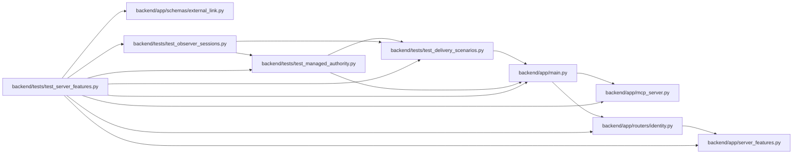

# test_server_features Module

**Path:** `backend/tests/test_server_features.py`

## Description

The public feature list names only features this server has.

## Imports

| Source | Symbols |
|--------|---------|
| `app.main` | `app` |
| `app.mcp_server` | `mcp` |
| `app.routers.identity` | `NativeConnectionStart` |
| `app.schemas.external_link` | `ExternalLinkProvider` |
| `app.server_features` | `SERVER_FEATURES` |
| `asyncio` | `asyncio` |
| `tests.test_delivery_scenarios` | `delivery_store` |
| `tests.test_managed_authority` | `client`, `managed_store` |
| `tests.test_observer_sessions` | `local_store` |

## Local dependency map

<!-- Auto-generated local dependency summary. Do not edit by hand. -->

### Internal neighbors

| Direction | Module |
|---|---|
| Outbound | [app_main](../modules/app_main.md) |
| Outbound | [mcp_server](../modules/mcp_server.md) |
| Outbound | [routers_identity](../modules/routers_identity.md) |
| Outbound | [schemas_external_link](../modules/schemas_external_link.md) |
| Outbound | [server_features](../modules/server_features.md) |
| Outbound | [test_delivery_scenarios](../modules/test_delivery_scenarios.md) |
| Outbound | [test_managed_authority](../modules/test_managed_authority.md) |
| Outbound | [test_observer_sessions](../modules/test_observer_sessions.md) |

## Functions

| Function | Signature | Decorators | Description |
|----------|-----------|------------|-------------|
| `routes` | `()` | — | — |
| `test_every_listed_feature_is_present_and_named_once` | `()` | — | — |
| `anonymous_features` | *(async)* `()` | — | — |
| `test_a_managed_server_lists_features_without_a_credential` | *(async)* `(managed_store)` | — | — |
| `test_a_trusted_local_server_lists_features_without_a_credential` | *(async)* `(local_store)` | — | — |
