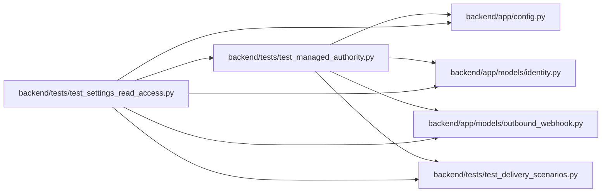

# test_settings_read_access Module

**Path:** `backend/tests/test_settings_read_access.py`

## Description

People without the admin key read settings and the pipeline; changes keep the key.

## Imports

| Source | Symbols |
|--------|---------|
| `app.config` | `get_settings` |
| `app.models.identity` | `Principal`, `WorkspaceAuthorityState` |
| `app.models.outbound_webhook` | `OutboundWebhookTarget` |
| `tests.test_delivery_scenarios` | `delivery_store` |
| `tests.test_managed_authority` | `client` |

## Local dependency map

<!-- Auto-generated local dependency summary. Do not edit by hand. -->

### Internal neighbors

| Direction | Module |
|---|---|
| Outbound | [config](../modules/config.md) |
| Outbound | [models_identity](../modules/models_identity.md) |
| Outbound | [models_outbound_webhook](../modules/models_outbound_webhook.md) |
| Outbound | [test_delivery_scenarios](../modules/test_delivery_scenarios.md) |
| Outbound | [test_managed_authority](../modules/test_managed_authority.md) |

## Functions

| Function | Signature | Decorators | Description |
|----------|-----------|------------|-------------|
| `test_settings_are_readable_without_the_key_and_sensitive_values_are_withheld` | *(async)* `(delivery_store, monkeypatch)` | — | — |
