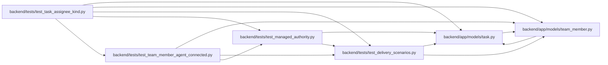

# test_task_assignee_kind Module

**Path:** `backend/tests/test_task_assignee_kind.py`

## Description

Task responses say whether the assignee is a person or an agent, to every reader of the task.

## Imports

| Source | Symbols |
|--------|---------|
| `app.models.task` | `Task` |
| `app.models.team_member` | `TeamMember` |
| `pytest` | `pytest` |
| `tests.test_delivery_scenarios` | `delivery_store` |
| `tests.test_managed_authority` | `client`, `managed_store` |
| `tests.test_team_member_agent_connected` | `READERS`, `_assert_names_no_agent`, `_seed_agent_members` |

## Local dependency map

<!-- Auto-generated local dependency summary. Do not edit by hand. -->

### Internal neighbors

| Direction | Module |
|---|---|
| Outbound | [models_task](../modules/models_task.md) |
| Outbound | [team_member](../modules/team_member.md) |
| Outbound | [test_delivery_scenarios](../modules/test_delivery_scenarios.md) |
| Outbound | [test_managed_authority](../modules/test_managed_authority.md) |
| Outbound | [test_team_member_agent_connected](../modules/test_team_member_agent_connected.md) |

### External packages

| Language | Used packages | Undeclared packages |
|---|---:|---:|
| python | 1 | 1 |

## Functions

| Function | Signature | Decorators | Description |
|----------|-----------|------------|-------------|
| `_assign_planned_task_to_the_connected_agent` | *(async)* `(factory, scenario)` | — | — |
| `_assignees` | `(payload)` | — | — |
| `test_every_reader_sees_the_assignee_kind_on_task_responses` | *(async)* `(managed_store, reader)` | `@pytest.mark.parametrize('reader', list(READERS))` | — |
