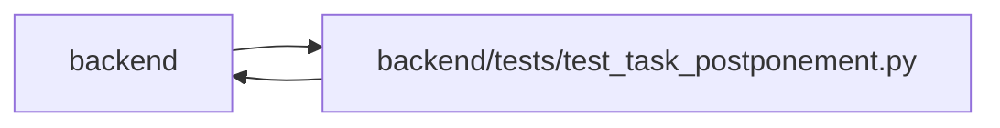

# test_task_postponement Module

**Path:** `backend/tests/test_task_postponement.py`

## Description

Postponed work stops natively, releases live execution under its fence, and resumes with its evidence intact.

## Imports

| Source | Symbols |
|--------|---------|
| `app.authority` | `Authority`, `AuthorityError` |
| `app.commands` | `PlanningConflict` |
| `app.main` | `app` |
| `app.models.agent` | `AgentActor`, `AgentRun`, `AgentTaskAssignment`, `TaskEvent` |
| `app.models.delivery_observation` | `DeliveryObservation` |
| `app.models.iteration` | `Iteration` |
| `app.models.task` | `Task` |
| `app.models.task_brief` | `TaskProgressRecord` |
| `app.models.task_postponement` | `TaskPostponement`, `TaskReactivationRequirement` |
| `app.models.task_status_log` | `TaskStatusLog` |
| `app.models.triage` | `TriageItem` |
| `app.schemas.task` | `TaskCreate`, `TaskUpdate` |
| `app.schemas.task_brief` | `BriefCriterion`, `CriterionProgress`, `ProgressWrite`, `TaskBrief`, `TaskReviewWrite` |
| `app.schemas.task_domain` | `TaskActionRequest` |
| `app.schemas.task_postponement` | `TaskPostponeRequest`, `TaskReactivateRequest` |
| `app.services.iteration_service` | `IterationService` |
| `app.services.snapshot_service` | `SnapshotService` |
| `app.services.task_brief_service` | `TaskBriefService` |
| `app.services.task_domain_service` | `TaskDomainService` |
| `app.services.task_postponement_service` | `TaskPostponementService`, `require_unreferenced` |
| `app.services.task_service` | `TaskService` |
| `app.services.task_status_service` | `TaskStatusService` |
| `app.utils.time` | `utc_now` |
| `datetime` | `timedelta` |
| `httpx` | `httpx` |
| `pydantic` | `ValidationError` |
| `pytest` | `pytest` |
| `re` | `re` |
| `sqlalchemy` | `func`, `select` |
| `tests.test_delivery_scenarios` | `delivery_store` |
| `tests.test_task_domain` | `human_context` |

## Local dependency map

<!-- Auto-generated local dependency summary. Do not edit by hand. -->

> Module-level dependencies exceed the generated-diagram limits, so the diagram and table below group them by top-level package. Counts report the number of module neighbors in each package.

### Internal neighbors

| Direction | Module |
|---|---|
| Inbound | `backend` (1) |
| Outbound | `backend` (25) |

### External packages

| Language | Used packages | Undeclared packages |
|---|---:|---:|
| python | 4 | 1 |

> All 26 module neighbor(s) are summarized by package because the module-level view exceeds the 12-node limit.

## Functions

| Function | Signature | Decorators | Description |
|----------|-----------|------------|-------------|
| `_later` | `(days = 30)` | — | — |
| `_postpone` | `(version, *requirements, reason = 'Waiting for the platform decision', **fence)` | — | — |
| `_client` | `()` | — | — |
| `_action` | `(actions, name)` | — | — |
| `test_postpone_from_each_open_status_records_reason_requirements_and_history` | *(async)* `(delivery_store, from_status)` | `@pytest.mark.parametrize('from_status', ['planned', 'active', 'resolved'])` | — |
| `test_other_moves_into_or_out_of_postponed_are_refused` | *(async)* `(delivery_store)` | — | — |
| `test_requirements_must_be_possible_and_not_already_met` | *(async)* `(delivery_store)` | — | — |
| `_live_execution` | *(async)* `(db, scenario)` | — | An active task with an expired claim, a queued execution assignment and a running run. |
| `test_postponing_live_work_releases_claim_assignment_and_run_under_the_fence` | *(async)* `(delivery_store)` | — | — |
| `_evidenced_task` | *(async)* `(db, scenario, *, resolve)` | — | — |
| `test_reactivation_returns_work_with_brief_progress_evidence_and_provenance_intact` | *(async)* `(delivery_store, from_status, returns_to)` | `@pytest.mark.parametrize('from_status, returns_to', [('active', 'planned'), ('resolved', 'resolved')])` | — |
| `_agent` | `(actor_id, role, project_id)` | — | — |
| `test_only_a_pm_project_manager_or_operator_decides` | *(async)* `(delivery_store)` | — | — |
| `test_deferred_and_postponed_are_independent` | *(async)* `(delivery_store)` | — | — |
| `test_summary_rolls_up_postponed_leaves` | *(async)* `(delivery_store)` | — | — |
| `test_cancel_and_reopen_keep_the_open_postponement` | *(async)* `(delivery_store)` | — | — |
| `test_snapshot_restore_cannot_move_work_into_or_out_of_postponed` | *(async)* `(delivery_store)` | — | — |
| `test_work_an_open_postponement_waits_for_cannot_be_deleted` | *(async)* `(delivery_store)` | — | — |
| `test_never_postponed_task_has_no_postponement_record` | *(async)* `(delivery_store)` | — | — |
