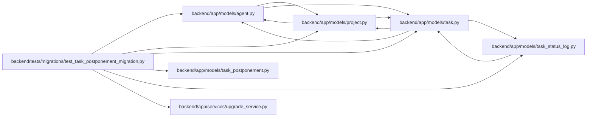

# test_task_postponement_migration Module

**Path:** `backend/tests/migrations/test_task_postponement_migration.py`

## Description

Task postponement migrates a populated database unchanged, and never loses postponed work on rollback.

## Imports

| Source | Symbols |
|--------|---------|
| `alembic` | `command` |
| `app.models.agent` | `AgentActor`, `AgentRun`, `AgentTaskAssignment` |
| `app.models.project` | `Project` |
| `app.models.task` | `Task`, `TaskDependency` |
| `app.models.task_postponement` | `TaskPostponement`, `TaskReactivationRequirement` |
| `app.models.task_status_log` | `TaskStatusLog` |
| `app.services.upgrade_service` | `alembic_config` |
| `datetime` | `date`, `datetime`, `timezone` |
| `pytest` | `pytest` |
| `sqlalchemy` | `create_engine`, `event`, `inspect`, `select` |
| `sqlalchemy.exc` | `IntegrityError` |

## Local dependency map

<!-- Auto-generated local dependency summary. Do not edit by hand. -->

### Internal neighbors

| Direction | Module |
|---|---|
| Outbound | [models_agent](../modules/models_agent.md) |
| Outbound | [models_project](../modules/models_project.md) |
| Outbound | [models_task](../modules/models_task.md) |
| Outbound | [models_task_postponement](../modules/models_task_postponement.md) |
| Outbound | [task_status_log](../modules/task_status_log.md) |
| Outbound | [upgrade_service](../modules/upgrade_service.md) |

### External packages

| Language | Used packages | Undeclared packages |
|---|---:|---:|
| python | 3 | 1 |

## Functions

| Function | Signature | Decorators | Description |
|----------|-----------|------------|-------------|
| `_populate` | `(db)` | — | Tasks in every prior status, with dependencies, history and agent execution. |
| `_rows` | `(db)` | — | — |
| `test_postponement_migration_upgrades_populated_data_and_refuses_losing_postponed_work` | `(dialect, request, tmp_path, configure_database)` | `@pytest.mark.parametrize('dialect', [pytest.param('sqlite', marks=pytest.mark.sqlite), pytest.param('postgresql', marks=[pytest.mark.postgresql, pytest.mark.integration, pytest.mark.allow_network])])` | — |
