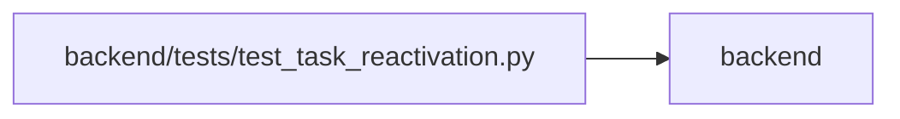

# test_task_reactivation Module

**Path:** `backend/tests/test_task_reactivation.py`

## Description

Postponed work returns to its lifecycle by itself once every recorded requirement holds.

## Imports

| Source | Symbols |
|--------|---------|
| `app.authority` | `Authority`, `AuthorityError` |
| `app.config` | `get_settings` |
| `app.main` | `app` |
| `app.models.agent` | `TaskEvent` |
| `app.models.capacity` | `PlanningState` |
| `app.models.outbound_webhook` | `OutboundWebhookEvent` |
| `app.models.project` | `Project` |
| `app.models.task` | `Task` |
| `app.models.task_postponement` | `TaskPostponement`, `TaskReactivationRequirement` |
| `app.models.task_status_log` | `TaskStatusLog` |
| `app.models.triage` | `TriageItem` |
| `app.schemas.task` | `TaskCreate` |
| `app.schemas.task_brief` | `TaskReviewWrite` |
| `app.schemas.task_domain` | `TaskActionRequest` |
| `app.schemas.task_postponement` | `OwnerDecisionRequest`, `TaskPostponeRequest`, `TaskReactivateRequest` |
| `app.schemas.triage` | `TriageActionRequest`, `TriageDuplicateRequest`, `TriageSnoozeRequest` |
| `app.services.task_brief_service` | `TaskBriefService` |
| `app.services.task_domain_service` | `TaskDomainService` |
| `app.services.task_postponement_service` | `TaskPostponementService` |
| `app.services.task_reactivation_service` | `ReactivationService` |
| `app.services.task_service` | `TaskService` |
| `app.services.triage_service` | `TriageService` |
| `app.utils.time` | `utc_now` |
| `asyncio` | `asyncio` |
| `datetime` | `datetime`, `timedelta`, `timezone` |
| `httpx` | `httpx` |
| `json` | `json` |
| `pytest` | `pytest` |
| `sqlalchemy` | `func`, `select`, `update` |
| `tests.test_delivery_scenarios` | `delivery_store` |
| `tests.test_task_postponement` | `_client`, `_evidenced_task`, `_later`, `_postpone` |

## Local dependency map

<!-- Auto-generated local dependency summary. Do not edit by hand. -->

> Module-level dependencies exceed the generated-diagram limits, so the diagram and table below group them by top-level package. Counts report the number of module neighbors in each package.

### Internal neighbors

| Direction | Module |
|---|---|
| Outbound | `backend` (25) |

### External packages

| Language | Used packages | Undeclared packages |
|---|---:|---:|
| python | 3 | 1 |

> All 25 module neighbor(s) are summarized by package because the module-level view exceeds the 12-node limit.

## Functions

| Function | Signature | Decorators | Description |
|----------|-----------|------------|-------------|
| `_owner` | `(principal_id = None)` | — | — |
| `_resolved_task` | *(async)* `(factory, scenario)` | — | Evidenced resolved work in the first project, with the reviewer who can accept it. |
| `_accept` | *(async)* `(factory, scenario, reviewer_id, task_id)` | — | — |
| `_postpone_task` | *(async)* `(factory, task_id, *requirements, authority = None)` | — | — |
| `_state` | *(async)* `(factory, task_id)` | — | — |
| `_requirement_states` | *(async)* `(client, task_id)` | — | — |
| `test_accepting_the_named_predecessor_reactivates_once_across_projects` | *(async)* `(delivery_store)` | — | — |
| `test_a_linked_triage_item_resolved_returns_resolved_work_to_resolved` | *(async)* `(delivery_store, closing)` | `@pytest.mark.parametrize('closing', ['accept', 'decline'])` | — |
| `test_snoozed_triage_item_keeps_work_postponed_and_a_duplicate_resolves_it` | *(async)* `(delivery_store)` | — | — |
| `test_a_linked_task_resolved_without_acceptance_is_enough` | *(async)* `(delivery_store)` | — | — |
| `test_a_date_requirement_reactivates_on_its_date_in_the_project_time_zone` | *(async)* `(delivery_store)` | — | — |
| `test_an_owner_decision_requirement_waits_for_the_owner_alone` | *(async)* `(delivery_store)` | — | — |
| `test_the_owner_decision_command_over_http` | *(async)* `(delivery_store)` | — | — |
| `test_all_four_kinds_reactivate_only_when_the_last_is_met` | *(async)* `(delivery_store)` | — | — |
| `test_a_later_postponement_waits_for_its_own_requirements` | *(async)* `(delivery_store)` | — | — |
| `test_two_triggers_arriving_together_reactivate_the_task_once` | *(async)* `(delivery_store)` | — | — |
| `test_two_final_triggers_race_and_exactly_one_reactivates` | *(async)* `(delivery_store)` | — | — |
| `_backlog_task` | *(async)* `(factory, project_id, title = 'Backlog item')` | — | — |
| `test_backlog_work_in_a_project_the_caller_cannot_read_reactivates` | *(async)* `(delivery_store)` | — | — |
| `test_the_date_check_reactivates_backlog_work_in_managed_mode` | *(async)* `(delivery_store, monkeypatch)` | — | — |
| `test_a_closed_summary_counts_as_an_accepted_predecessor` | *(async)* `(delivery_store)` | — | — |
| `test_reactivating_to_resolved_with_the_command_wakes_work_waiting_for_it` | *(async)* `(delivery_store)` | — | — |
| `test_a_sweep_that_finds_nothing_leaves_the_planning_revision_alone` | *(async)* `(delivery_store)` | — | — |
| `test_a_failed_evaluation_never_blocks_the_trigger_and_is_retried` | *(async)* `(delivery_store, monkeypatch, failure)` | `@pytest.mark.parametrize('failure', [RuntimeError('boom'), TypeError('odd')])` | — |
| `test_the_owner_decision_also_counts_a_date_that_came_due` | *(async)* `(delivery_store)` | — | — |
