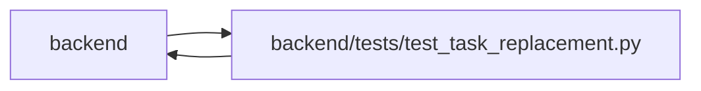

# test_task_replacement Module

**Path:** `backend/tests/test_task_replacement.py`

## Description

A clean replacement of unattributable work: audited, counted once, and held when it carries unknown work.

## Imports

| Source | Symbols |
|--------|---------|
| `app.authority` | `Authority`, `AuthorityError` |
| `app.commands` | `PlanningConflict`, `command_transaction`, `PlanningConflict` |
| `app.config` | `get_settings` |
| `app.main` | `app` |
| `app.models.agent` | `AgentModelCatalogEntry`, `AgentRun`, `AgentTaskAssignment` |
| `app.models.delivery_dependency` | `DeliveryDependency` |
| `app.models.delivery_observation` | `DeliveryObservation` |
| `app.models.iteration` | `Iteration` |
| `app.models.project` | `Project` |
| `app.models.recovery` | `ApplicationSnapshot` |
| `app.models.release` | `Release`, `release_tasks` |
| `app.models.task` | `Task`, `TaskDependency` |
| `app.models.task_replacement` | `TaskReplacement` |
| `app.refusal_next_steps` | `NEXT_STEPS`, `VARIANTS` |
| `app.schemas.task_replacement` | `TaskReplacementCreate` |
| `app.services.backlog_snapshot_service` | `BacklogSnapshotService` |
| `app.services.delivery_dependency_service` | `DeliveryDependencyService`, `DeliveryDependencyService` |
| `app.services.delivery_metrics_service` | `summarize_observations` |
| `app.services.github_status_service` | `GitHubStatusService` |
| `app.services.release_service` | `ReleaseService` |
| `app.services.review_provenance` | `execution_profile_history` |
| `app.services.snapshot_service` | `SnapshotService` |
| `app.services.task_brief_service` | `TaskBriefService` |
| `app.services.task_domain_service` | `TaskDomainService` |
| `app.services.task_replacement_service` | `TaskReplacementService`, `carried_contributors` |
| `app.services.work_metrics` | `leaf_metrics` |
| `app.utils.time` | `utc_now` |
| `datetime` | `timedelta` |
| `httpx` | `httpx` |
| `json` | `json` |
| `pytest` | `pytest` |
| `sqlalchemy` | `select` |
| `tests.test_agent_team_setup_qualification` | `_TASK_BRIEF`, `provision_ready_topology`, `routing_base` |
| `tests.test_review_provenance_transports` | `databases`, `fence` |
| `tests.test_scoped_review_evidence` | `through` |
| `tests.test_team_pm_dispatch` | `db_session_factory` |
| `tests.test_team_pm_recovery` | `recovery_api` |
| `types` | `SimpleNamespace` |

## Local dependency map

<!-- Auto-generated local dependency summary. Do not edit by hand. -->

> Module-level dependencies exceed the generated-diagram limits, so the diagram and table below group them by top-level package. Counts report the number of module neighbors in each package.

### Internal neighbors

| Direction | Module |
|---|---|
| Inbound | `backend` (1) |
| Outbound | `backend` (32) |

### External packages

| Language | Used packages | Undeclared packages |
|---|---:|---:|
| python | 3 | 1 |

> All 33 module neighbor(s) are summarized by package because the module-level view exceeds the 12-node limit.

## Functions

| Function | Signature | Decorators | Description |
|----------|-----------|------------|-------------|
| `restore_settings_cache` | `()` | `@pytest.fixture(autouse=True)` | — |
| `_scenario` | *(async)* `(db, task_factory, team_member_factory, *, strict = True)` | — | An original whose only run was executed without a model binding, so its publisher is unknown. |
| `_replacement` | `(original, replacement, carried)` | — | — |
| `test_clean_replacement_is_accepted_once_and_carried_work_stays_held` | *(async)* `(db_session, db_session_factory, task_factory, team_member_factory, monkeypatch, transport, reuse)` | `@databases`, `@pytest.mark.parametrize('transport', ['rest', 'mcp'])`, `@pytest.mark.parametrize('reuse', ['clean', 'carried'])`, `@pytest.mark.usefixtures('deployed_agent_skill_release')` | — |
| `test_replacement_read_and_human_route_authority` | *(async)* `(db_session, db_session_factory, task_factory, team_member_factory, monkeypatch, transport)` | `@databases`, `@pytest.mark.parametrize('transport', ['rest', 'mcp'])`, `@pytest.mark.usefixtures('deployed_agent_skill_release')` | — |
| `_plain` | *(async)* `(db, task_factory, *, status = 'resolved')` | — | — |
| `_data` | `(original, replacement, **overrides)` | — | — |
| `test_replacement_refuses_ineligible_pairs` | *(async)* `(db_session, task_factory, monkeypatch)` | `@pytest.mark.sqlite` | — |
| `test_only_a_project_manager_or_pm_actor_decides` | *(async)* `(db_session, task_factory, kind, role, scopes, allowed)` | `@pytest.mark.sqlite`, `@pytest.mark.parametrize(('kind', 'role', 'scopes', 'allowed'), [('human', None, (), False), ('human', None, (), True), ('agent', 'worker', ('planning:read', 'planning:write'), False), ('agent', 'pm', ('planning:read', 'planning:write'), True)])` | — |
| `test_held_replacement_is_refused_acceptance_without_the_strict_policy` | *(async)* `(db_session, task_factory, monkeypatch, actor_factory)` | `@pytest.mark.sqlite` | — |
| `test_an_owner_override_cannot_accept_a_held_replacement_so_no_next_step_offers_it` | *(async)* `(db_session, task_factory, monkeypatch, actor_factory)` | `@pytest.mark.sqlite` | — |
| `test_carried_contributor_cannot_verify_without_the_strict_policy` | *(async)* `(db_session, db_session_factory, task_factory, team_member_factory, actor_factory, monkeypatch, transport, overlap)` | `@databases`, `@pytest.mark.parametrize('transport', ['rest', 'mcp'])`, `@pytest.mark.parametrize('overlap', ['same_actor', 'same_profile'])`, `@pytest.mark.usefixtures('deployed_agent_skill_release')` | — |
| `test_a_chained_replacement_inherits_the_earlier_carried_work` | *(async)* `(db_session, task_factory, actor_factory, monkeypatch)` | `@pytest.mark.sqlite` | — |
| `_replaced_pair` | *(async)* `(db, task_factory, *, backlog)` | — | — |
| `test_restoring_a_pre_replacement_snapshot_is_refused` | *(async)* `(db_session, task_factory, monkeypatch, scope)` | `@databases`, `@pytest.mark.parametrize('scope', ['iteration', 'backlog'])` | — |
