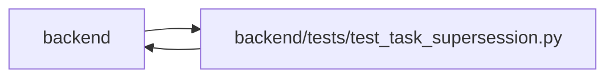

# test_task_supersession Module

**Path:** `backend/tests/test_task_supersession.py`

## Description

An original superseded by work already closed or accepted: nothing reopens, and the deliverable counts once.

## Imports

| Source | Symbols |
|--------|---------|
| `app.authority` | `Authority`, `AuthorityError` |
| `app.commands` | `PlanningConflict` |
| `app.config` | `get_settings` |
| `app.main` | `app` |
| `app.models.agent` | `TaskEvent`, `AgentTaskAssignment` |
| `app.models.delivery_dependency` | `DeliveryDependency` |
| `app.models.delivery_observation` | `DeliveryObservation` |
| `app.models.identity` | `Principal` |
| `app.models.iteration` | `Iteration` |
| `app.models.project` | `ProjectMilestone` |
| `app.models.release` | `Release`, `release_tasks` |
| `app.models.task` | `Task`, `TaskDependency` |
| `app.models.task_brief` | `TaskReviewRecord` |
| `app.models.task_postponement` | `TaskPostponement`, `TaskReactivationRequirement` |
| `app.models.task_replacement` | `TaskReplacement` |
| `app.schemas.task_replacement` | `TaskReplacementCreate`, `TaskSupersessionCreate` |
| `app.services` | `task_replacement_service` |
| `app.services.delivery_dependency_service` | `DeliveryDependencyService` |
| `app.services.release_service` | `ReleaseService` |
| `app.services.task_brief_service` | `TaskBriefService` |
| `app.services.task_domain_service` | `TaskDomainService` |
| `app.services.task_replacement_service` | `TaskReplacementService`, `delivering_leaves` |
| `app.services.task_service` | `TaskVersionConflictError` |
| `app.services.work_metrics` | `leaf_metrics` |
| `app.utils.time` | `utc_now` |
| `datetime` | `timedelta` |
| `httpx` | `httpx` |
| `pytest` | `pytest` |
| `sqlalchemy` | `select` |
| `tests.test_delivery_scenarios` | `delivery_store` |
| `types` | `SimpleNamespace` |
| `unittest.mock` | `Mock` |

## Local dependency map

<!-- Auto-generated local dependency summary. Do not edit by hand. -->

> Module-level dependencies exceed the generated-diagram limits, so the diagram and table below group them by top-level package. Counts report the number of module neighbors in each package.

### Internal neighbors

| Direction | Module |
|---|---|
| Inbound | `backend` (1) |
| Outbound | `backend` (25) |

### External packages

| Language | Used packages | Undeclared packages |
|---|---:|---:|
| python | 3 | 1 |

> All 26 module neighbor(s) are summarized by package because the module-level view exceeds the 12-node limit.

## Functions

| Function | Signature | Decorators | Description |
|----------|-----------|------------|-------------|
| `_client` | `()` | — | — |
| `_supersede` | `(original, successor, **overrides)` | — | — |
| `_accept` | *(async)* `(db, task)` | — | — |
| `_postponed` | *(async)* `(db, project_id, iteration_id, target_id, *, reactivated = False)` | — | — |
| `_scenario` | *(async)* `(db, scenario, *, successor_state)` | — | A resolved original with dependents, releases and a waiting postponement; its successor already delivered. |
| `test_supersession_moves_dependents_releases_and_requirements_and_counts_once` | *(async)* `(delivery_store, successor_state)` | `@pytest.mark.parametrize('successor_state', ['accepted', 'closed'])` | — |
| `test_an_already_canceled_original_keeps_its_cancel_reason` | *(async)* `(delivery_store)` | — | — |
| `_with_service` | *(async)* `(factory, call)` | — | — |
| `test_supersession_refuses_ineligible_pairs` | *(async)* `(delivery_store)` | — | — |
| `test_the_fresh_replacement_still_refuses_a_closed_replacement` | *(async)* `(delivery_store)` | — | — |
| `test_only_a_project_manager_or_pm_actor_supersedes` | *(async)* `(delivery_store, kind, role, project_role, allowed)` | `@pytest.mark.parametrize(('kind', 'role', 'project_role', 'allowed'), [('human', None, 'editor', False), ('human', None, 'manager', True), ('agent', 'worker', 'manager', False), ('agent', 'pm', 'manager', True)])` | — |
| `_frozen` | `(*tasks)` | — | — |
| `_refused` | *(async)* `(factory, original, successor, *, expected = PlanningConflict, **overrides)` | — | — |
| `test_a_milestone_whose_only_leaf_was_superseded_counts_the_successor` | *(async)* `(delivery_store, successor_state)` | `@pytest.mark.parametrize('successor_state', ['accepted', 'closed'])` | — |
| `test_a_schedule_dependent_follows_a_successor_in_another_iteration_as_a_delivery_prerequisite` | *(async)* `(delivery_store)` | — | — |
| `test_edges_to_the_successor_merge_and_its_own_edges_to_the_original_are_removed` | *(async)* `(delivery_store)` | — | — |
| `test_a_dependency_cycle_is_refused_and_rolls_back` | *(async)* `(delivery_store)` | — | — |
| `test_supersession_refuses_stale_live_summary_and_unauthorized_moves` | *(async)* `(delivery_store)` | — | — |
| `_refused_with` | *(async)* `(factory, call, original, expected)` | — | — |
| `test_a_worker_agent_cannot_supersede_over_rest` | *(async)* `(delivery_store, monkeypatch)` | — | — |
| `test_a_postponed_original_has_its_postponement_closed` | *(async)* `(delivery_store)` | — | — |
| `test_the_successor_of_a_supersession_cannot_be_canceled_but_a_fresh_replacement_can` | *(async)* `(delivery_store)` | — | — |
| `test_a_supersession_chain_beyond_the_bound_reads_as_not_delivered_and_warns` | *(async)* `(delivery_store, monkeypatch)` | — | — |
