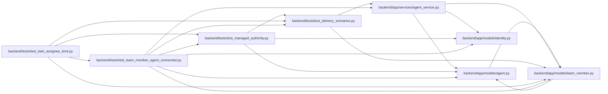

# test_team_member_agent_connected Module

**Path:** `backend/tests/test_team_member_agent_connected.py`

## Description

Team-member responses say whether an agent is connected, to every reader, without naming it.

## Imports

| Source | Symbols |
|--------|---------|
| `app.models.agent` | `AgentActor` |
| `app.models.identity` | `WorkspaceMembership` |
| `app.models.team_member` | `TeamMember`, `TeamMemberProfile` |
| `app.services.agent_service` | `hash_api_key` |
| `pytest` | `pytest` |
| `tests.test_delivery_scenarios` | `delivery_store` |
| `tests.test_managed_authority` | `client`, `managed_store` |

## Local dependency map

<!-- Auto-generated local dependency summary. Do not edit by hand. -->

### Internal neighbors

| Direction | Module |
|---|---|
| Inbound | [test_task_assignee_kind](../modules/test_task_assignee_kind.md) |
| Outbound | [models_agent](../modules/models_agent.md) |
| Outbound | [models_identity](../modules/models_identity.md) |
| Outbound | [team_member](../modules/team_member.md) |
| Outbound | [agent_service](../modules/agent_service.md) |
| Outbound | [test_delivery_scenarios](../modules/test_delivery_scenarios.md) |
| Outbound | [test_managed_authority](../modules/test_managed_authority.md) |

### External packages

| Language | Used packages | Undeclared packages |
|---|---:|---:|
| python | 1 | 1 |

## Functions

| Function | Signature | Decorators | Description |
|----------|-----------|------------|-------------|
| `_seed_agent_members` | *(async)* `(factory, scenario, people, *, workspace_member = True)` | — | One connected agent, one whose only actor is disabled, one still onboarding, beside the human row. |
| `test_every_reader_sees_agent_connected_on_the_embedded_profile` | *(async)* `(managed_store, reader)` | `@pytest.mark.parametrize('reader', list(READERS))` | — |
| `test_reader_without_profile_access_still_cannot_read_the_profile` | *(async)* `(managed_store)` | — | The team row carries the reader-safe part; the profile endpoints stay closed to that reader. |
| `_assert_names_no_agent` | `(text)` | — | — |
| `test_single_member_read_carries_agent_connected` | *(async)* `(managed_store, workspace_member)` | `@pytest.mark.parametrize('workspace_member', [True, False], ids=['workspace member', 'project-only member'])` | — |
